# th3-skills

<p align="center"></p>

Skills for Claude Code, installable via [`npx skills`](https://dev.to/baltz/sharing-skills-with-npx-2nbc).

## Install as a Claude Code plugin (all skills)

```
/plugin install th3-skills --marketplace th3r-dev/th3-skills
```

## Install a skill

```
npx skills@latest add th3r-dev/th3-skills --skill poc-spec-driven-builder
```

## Skills

-  [`poc-spec-driven-builder`](skills/shipped/poc-spec-driven-builder/SKILL.md) — builds a proof of concept end-to-end: research → SRS → council review → test matrix → implementation → verification, run autonomously without pausing for clarification.
-  [`thai-mock-naming`](skills/shipped/thai-mock-naming/README.md) — Thai mock names that are unmistakably fake, greppable in a database, and still exercise real Thai text handling. Replaces สมชาย ใจดี / สมหญิง พอใจ with marker names like ทดสอบ นามสมมุติ. Ships a generator and a linter.
-  [`documentation`](skills/shipped/documentation/SKILL.md) — documentation toolkit, one skill with two sub-skills: `doc-style` documents any work product (API, deploy, system, release) in one house style, with seven document skeletons, a TH Sarabun theme with change highlighting, and Markdown → PDF + DOCX in one command; `pdf-operations` merges, splits, reorders, rotates and overlays PDFs through an existing `pdf-lib` pipeline instead of writing a new one.

-  [`game-dev`](skills/shipped/game-dev/SKILL.md) — game development for any coding agent (Claude Code, Codex, Cursor, Gemini CLI), one skill with seven sub-skills, run as one flow: an idea grill, motivation, one-page brief, engine, a first build that is run and looked at, then one feature a sitting until it ships. The flow follows [th3 Game Studio](https://github.com/th3r-dev/th3-game-studio), a fork of [Claude Code Game Studios](https://github.com/Donchitos/Claude-Code-Game-Studios) that adds Roblox. `idea-grill` turns an idea into a first game that ships: a grill one question at a time, a check of what already works on Roblox and how players use it, the idea as one twist on a proven loop, few systems with a long ladder of tiers, and dated milestones from prototype through alpha and beta to launch; its monetization reference covers passes, products, rewarded ads, Creator Rewards and fair speed-ups. `design-lens` designs from player motivation: MDA read through Octalysis's core drives, after Rustaggi and Parashar's *Unified Theory of Game Design*, with a white-hat / black-hat audit for anything paid. `roblox` sets up Roblox Studio with Luau in files (Rojo, Rokit, Selene, StyLua, Lune tests) and wires Studio's built-in MCP server to the agent so it can playtest, read the output and take screenshots; its Luau reference sets a class + factory house style on Roblox's style guide and luau.org, and deeper topics (DataStores, networking, UI, physics, monetization) route to the pinned [roblox-suite](https://github.com/nonlooped/roblox-suite). `roblox-vfx` makes effects with ParticleEmitter, Beam, Trail and Highlight under a fill-rate budget, the server deciding and the client rendering, with a recipe for power abilities (after [roblox-suite](https://github.com/nonlooped/roblox-suite)). `engine-mcp` wires the agent to any engine's MCP server, official first and every package pinned: Roblox Studio, Unity, Unreal, Godot, Blender, web games through [Chrome DevTools MCP](https://github.com/ChromeDevTools/chrome-devtools-mcp) or [Playwright MCP](https://github.com/microsoft/playwright-mcp), and Bevy. `engine_mcp.py` writes the entry for Claude Code, Codex, Cursor, Gemini CLI or VS Code, and the agent proves it by playing, reading the logs and taking a screenshot. `design-ui` designs the game's interface as design-core applied to Roblox: an approved brief per surface with every state (after [AshExplained/roblox-skills](https://github.com/AshExplained/roblox-skills), MIT), phone-first layout inside Roblox's safe insets and clear of chat and the touch controls, colours from the game's tokens, the server deciding every purchase, and a Studio playtest captured per device; its Craghold example was built, run and fixed in Studio. `modeling` makes 3D models in the open Blender through the official Blender Lab MCP add-on, looking at the viewport after every stage, with the Blender craft (UVs, materials, rigs, the asset-qa gate, Roblox export presets) routed to [blender-skills](https://github.com/el4cteo/blender-skills) (MIT, pinned); its live worked case is Craghold's dungeon key. Headless scripts remain the fallback (after [Blender Agent Studio](https://github.com/ifBars/blender-agent-studio) and [blender-claude-plugin](https://github.com/ra100/blender-claude-plugin)), exports FBX for Roblox or GLB for the web, and `mesh_check.py` checks the file against the engine's limits before import; [Meshy](https://github.com/meshy-dev/meshy-3d-agent) generation is used only when the user says they have its CLI. Stdlib scripts, `--dry-run` first.

-  [`containers`](skills/shipped/containers/SKILL.md) — container runtime toolkit, one skill with sub-skills per runtime. `podman` reclaims Podman disk space on Windows, macOS and Linux: prunes unused images, runs `fstrim` in the Podman machine, and on Windows compacts the WSL `ext4.vhdx` so the space actually returns to the host. One stdlib-only Python script, `--dry-run` first.

-  [`agent-kit`](skills/shipped/agent-kit/SKILL.md) — agent toolkit, one skill with four sub-skills: `cost` routes each agent to the cheapest model tier that can finish it, gives it a checkable finish line and skips agents the task doesn't need, with a PreToolUse hook that nudges every Agent call that sets no model; `prompt-cache` keeps prompt prefixes byte-identical so the prompt cache hits: a uv-run script builds a fingerprinted project outline, writes agent briefs that put it first and the task last, and reports per-agent hit rate from the local session logs; `team` runs role agents as a standing team on a project's GitHub issues: the main session is the lead (`/team-tick` on a `/loop`), workers take issues in their own worktrees and open draft PRs, a reviewer and (for games) a Studio playtester hand them to the owner, and every handoff is a label or PR comment that any session or tool can pick up; `rag` gives agents project memory without breaking the cache: a local Obsidian-compatible vault ([claude-obsidian](https://github.com/AgriciDaniel/claude-obsidian) layout) kept out of git, stdlib BM25 retrieval, and briefs that put the retrieved notes after the shared prefix.

-  [`dependency-vuln-explainer`](skills/shipped/dependency-vuln-explainer/SKILL.md) — explains a vulnerable dependency (Dependabot alert, GHSA/CVE, `npm audit`) so a person can see how the attack works and whether it reaches their app. Traces the lockfile path, rates real reachability instead of repeating the CVSS score, ranks fix options, draws the exploit and dependency path with `diagram-design`, and leaves a vuln card other agents can act on. Optional sandboxed repro via `poc-spec-driven-builder` in a network-less container. Optional anonymized one-minute explainer video with Bloom (Thai narration, pixel character, captions). Benchmarked on a real liquidjs RCE alert (CVSS 10.0 → low real priority).

-  [`design`](skills/shipped/design/SKILL.md) — design toolkit, one skill with four sub-skills. `core`, the shared principles: composition (Figma's graphic design principles), interface writing (Apple HIG Writing), and an interface quality baseline drawn from [open-design](https://github.com/nexu-io/open-design) (states, accessibility, motion, AI tells), a staged working order from brief to handoff, a taste pass adapted from [taste-skill](https://github.com/Leonxlnx/taste-skill) (classify the kind, copy before layout, deliberate choices, gate-style checks), and a reference-first loop adapted from [cook](https://github.com/Leonxlnx/cook) (9–12 references via [Inspo](https://github.com/Nutlope/inspo) / [Awwwards](https://github.com/INSANE0777/Awwwards-mcp) MCP, three static variants first, layout before motion, fresh-context critics with calibrated scores), a picture-to-3D teardown method adapted from [cutaway](https://github.com/Nyxera0x/cutaway) (one picture rebuilt in three.js from code, graded and measured against the picture, still before film, handed over as an interactive page the viewer drives by hand and checked by `check_page.mjs`; a 60 fps film with a timeline-synced score on request), defaults for products with no design system, and a 0–10 review table. It defers to the product's own design system. `flow` puts real screens into Figma with their flowchart beside them. It captures live pages or HTML as editable auto-layout layers, binds every value to the file's variables and text styles (and asks before adding missing ones), fills placeholder slots or versions changed screens on the canvas, and builds flows from the file's own flow kit. Runs through a containerized [figma-mcp-bridge](https://github.com/gethopp/figma-mcp-bridge), so Figma's API and MCP call limits don't apply. Python tools, guide in its README. `banner-design` designs banners with the brand on one side and four steps of what the product does: exact sizes for GitHub, social, display ads, web and print, 22 art directions, rules merged from AlphaGraphics, Adobe Express and ui-ux-pro-max's banner-design, and a `bench.py` that exports the PNGs and checks the safe zone, contrast, phone-width type and file size. Its worked example is this repo's GitHub social preview. `thumbnail-keyart` makes game thumbnails and key art that show what the game is, what you do and the goal: a TOON brief maps each beat to one thing in the frame, the art carries no text, the bench adds Roblox's bottom band and 3 MB limit (after Roblox staff's thumbnail-personalization tips), and `critic.py` has a vision model read the thumbnail blind and scores that read against the brief.

-  [`marketing`](skills/shipped/marketing/SKILL.md) — selling a service and telling people about it, one skill with four sub-skills: `strategy` (who it is for, the promise, the offer ladder, the funnel and metrics, from DataRockie and Salesforce frameworks), `pricing` (measures the marketplace category with `fastwork_market.py`, prices packages from real costs and an income target with labelled averages for unknowns, and `offer.py price` flags any package that loses money) and `listing` (writes the listing in the platform's own field layout, makes the service, work-steps and work-sample images with banner-design, and `offer.py check` verifies limits, units, symbols, stack-free wording and that every number matches the offer) and `social-media`, itself two sub-skills: `blog-post` turns a topic or finished work into five titles, six typed hooks (after [social-media-skills](https://github.com/charlie947/social-media-skills)) and a Thai or English post grounded only in supplied facts, written with `kien-thai` for Thai, reviewed with `humanizer`, and closed with an "if you want ..." hook and the author's hire link; `blog-cover` renders the post's cover (1200 × 630 and 1920 × 1080) through design's banner-design engine, with Kanit, Anuphan and Mali for Thai. Posts are benchmarked against cases kept in TOON (prompt, English translation, facts, rubric) by a stdlib `bench_post.py`. Its worked case is a Thai making-of post about the th3r Fastwork banner, 7/7 on its rubric. The marketing worked case is a four-package Fastwork web service.

-  [`qa`](skills/shipped/qa/SKILL.md) — QA toolkit for web portals, one skill with four sub-skills and their scripts: `answer-review` (review a meeting Q&A sheet through business · program · data · operation lenses and write one Remark per row), `export-evidence` (walk every CSV / Excel / PDF export button on a signed-in Chrome, verify the files, build the .xlsx evidence report), `excel-import` (design, preflight, run and verify a test set for an Excel-template import, with a pluggable adapter for the importer) and `ticket-report` (post a QA / retest result on a Jira ticket in the team format with screenshots inline). Generalised from a Thai-government integration project.

-  [`devops`](skills/shipped/devops/SKILL.md) — DevOps toolkit, one skill with three sub-skills and their scripts: `change` (infra work on real machines in a fixed order — triage, read-only investigation, evidence, approved plan, stepwise change, same-command verification, blameless review — closed with a before / steps / after / rollback report; `jssh.py` jump-host ssh from an ini, `snapshot_haproxy.sh` for the config a container is *really* running), `release-scope` (what ships in the next release vs what prod runs, by ticket keys across every repo plus the issue boards, written as the PM list and checked against the customer message) and `network-diagram` (one draw.io file with a board per version → clean one-page PDF; rebuild a drawio from a final PDF; benchmark text / layout / pixels). Generalised from a Thai-government integration project.

## Skills by occupation

Grouped by SOC occupation, the classification [SkillsMP](https://skillsmp.com/creators/th3r-dev/th3-skills) browses by.

| Occupation | Skills |
|---|---|
| [Software Developers](https://skillsmp.com/occupations/software-developers) | [`poc-spec-driven-builder`](skills/shipped/poc-spec-driven-builder/SKILL.md), [`agent-kit`](skills/shipped/agent-kit/SKILL.md), [`thai-mock-naming`](skills/shipped/thai-mock-naming/SKILL.md) |
| [Software Quality Assurance Analysts and Testers](https://skillsmp.com/occupations/software-quality-assurance-analysts-and-testers) | [`qa`](skills/shipped/qa/SKILL.md), [`thai-mock-naming`](skills/shipped/thai-mock-naming/SKILL.md) |
| [Network and Computer Systems Administrators](https://skillsmp.com/occupations/network-and-computer-systems-administrators) | [`devops`](skills/shipped/devops/SKILL.md), [`containers`](skills/shipped/containers/SKILL.md) |
| [Information Security Analysts](https://skillsmp.com/occupations/information-security-analysts) | [`dependency-vuln-explainer`](skills/shipped/dependency-vuln-explainer/SKILL.md) |
| [Web and Digital Interface Designers](https://skillsmp.com/occupations/web-and-digital-interface-designers) | [`design`](skills/shipped/design/SKILL.md) |
| [Video Game Designers](https://skillsmp.com/occupations/video-game-designers) | [`game-dev`](skills/shipped/game-dev/SKILL.md) |
| [Technical Writers](https://skillsmp.com/occupations/technical-writers) | [`documentation`](skills/shipped/documentation/SKILL.md) |

## Related

- [agent-skills](https://github.com/addyosmani/agent-skills) by Addy Osmani — spec → plan → build → test → review → ship skills and reviewer personas. `agent-kit`'s `team` follows its orchestration rule: the user or a command orchestrates, personas never call personas.
- [9arm-skills](https://github.com/thananon/9arm-skills) by thananon — `scrutinize`, `debug-mantra`, `post-mortem`, `qwenchance`. This repo's `shipped/` / `in-progress/` layout comes from its bucket folders.
- [kien-thai (เขียนไทย)](https://github.com/chakrit/kien-thai) by chakrit — a skill for writing Thai that Thai readers find easy to read. Pairs with `thai-mock-naming`: that skill handles the Thai prose in free-text fields, this one handles the identity fields.

## License

MIT — see [LICENSE](LICENSE).
