<p align="center"></p>

# agent-kit

Agent toolkit, one skill with sub-skills for running Claude Code agents cheaply.

| Sub-skill | What it does |
|---|---|
| [`cost`](cost/SKILL.md) | Routes each agent to the cheapest model tier that can finish it, gives it a checkable finish line, and skips agents the task doesn't need. A PreToolUse hook nudges every Agent call that sets no model |
| [`prompt-cache`](prompt-cache/SKILL.md) | Keeps agent prompt prefixes byte-identical so the prompt cache hits: a fingerprinted project outline, briefs that put it first and the task last, and per-agent hit rate from the session logs |

The agent's instructions are in [SKILL.md](SKILL.md).

```
npx skills@latest add th3r-dev/th3-skills --skill agent-kit
```
