<p align="center"></p>

# containers

Container runtime toolkit, one skill with sub-skills per runtime.

| Sub-skill | What it does |
|---|---|
| [`podman`](podman/SKILL.md) | Reclaims Podman disk space on Windows, macOS and Linux: prunes unused images, runs `fstrim` in the Podman machine, and on Windows compacts the WSL `ext4.vhdx` so the space returns to the host |

The agent's instructions are in [SKILL.md](SKILL.md).

```
npx skills@latest add th3r-dev/th3-skills --skill containers
```
