<p align="center"></p>

# dependency-vuln-explainer

Does this CVE actually reach you? How the attack works, and whether your code ever calls it.

The agent's instructions are in [SKILL.md](SKILL.md).

```
npx skills@latest add th3r-dev/th3-skills --skill dependency-vuln-explainer
```
