<p align="center"></p>

# design-core

Design from references, not adjectives. A critic that didn’t build it decides when it’s done.

The agent's instructions are in [SKILL.md](SKILL.md).

```
npx skills@latest add th3r-dev/th3-skills --skill design-core
```
