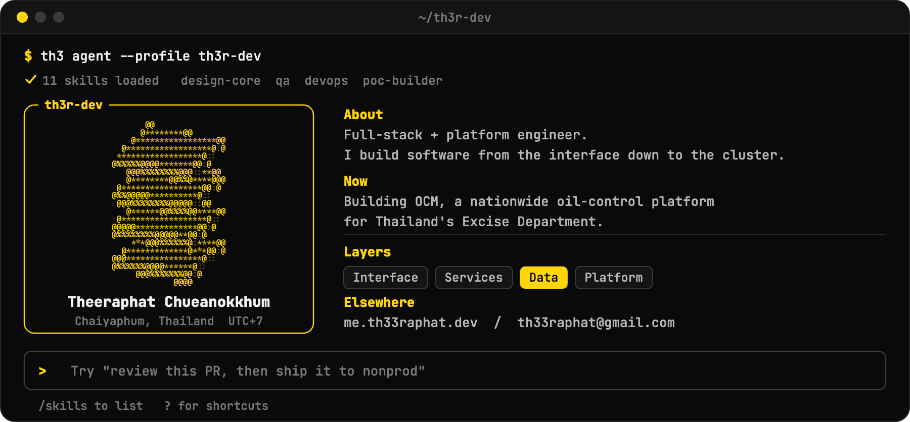
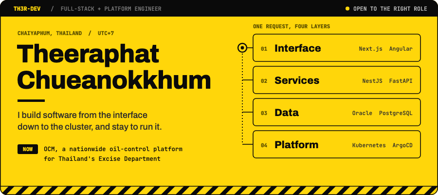
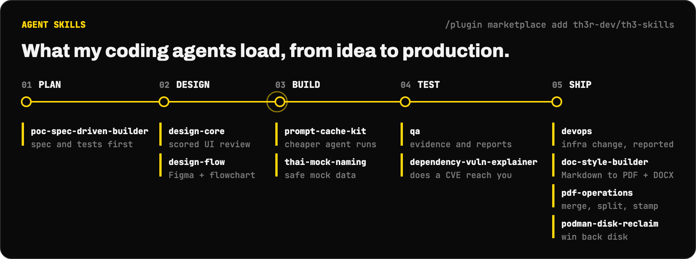

# Worked example: animated GitHub profile

A GitHub profile README for [th3r-dev](https://github.com/th3r-dev). It has two animated SVGs, a hero and an agent-skills panel, in black and yellow. It was designed with design-core and is kept here to show the method on a real piece of work, including the first version that failed review.

| File | What it is |
|---|---|
| [hero.svg](hero.svg) | Yellow poster: name, statement, and one request traced through four layers |
| [agents.svg](agents.svg) | Black panel: an agent moving along Plan → Design → Build → Test → Ship, with the skills used at each stage |
| [src/build.py](src/build.py) | Generator for both files. Run `python src/build.py .` (needs `fonttools` and `brotli`) |
| [src/fonts/](src/fonts) | Archivo and JetBrains Mono, subset and embedded at build time (SIL OFL 1.1, licenses included) |
| [shots/](shots) | Renders of v1 (rejected) and v2 |

## Brief

- **Ask:** "An animated SVG hero like this reference, in yellow and black, plus a section showing I work with AI agents."
- **Reference:** [Leonxlnx/Leonxlnx `assets/profile/hero.svg`](https://github.com/Leonxlnx/Leonxlnx/blob/main/assets/profile/hero.svg). Only the technique was used: one self-contained SVG, an embedded subset font, CSS keyframes, and frames swapped with `step-end` opacity. Nothing from the file was copied.
- **Kind** ([taste.md §1](../../references/taste.md#1-classify-the-work-first)): tech page. The real material leads: the person's layers, the platform they run, and the skills they ship.
- **Job:** "A visitor to the profile can tell in five seconds what this engineer owns and how they work with agents."

## v1: rejected for following the reference too closely

v1 was a dark terminal window with a welcome box, a spinning ASCII object, labelled About/Now sections and a prompt bar. Apart from the colours, that is the reference's own concept. The user's verdict was "rework the UI so it's different from the reference."

**Lesson:** treat a reference as a source of technique, not of composition. Before building, list what the reference does (layout, metaphor, motion) and decide which of those you are *not* taking. Without that list, "inspired by" turns into a copy with new colours, and the [taste.md §3](../../references/taste.md#3-decide-open-choices-on-purpose) rule against taking the first idea doesn't trigger, because the reference counts as the first idea.

## v2: shipped

### Open choices, decided on purpose

| Choice | Options considered | Pick and why |
|---|---|---|
| Metaphor | Terminal session · system diagram · signage poster | **Poster plus a diagram.** It moves away from the reference's terminal, and the diagram shows the person's real claim: interface down to the cluster |
| Ground | Black with yellow accents · yellow with black type | **Yellow hero, black skills panel.** The page alternates between the two, and black on `#FFD60A` is far above AA contrast |
| Yellow | `#FFC400` (reads orange) · `#FFE600` (vibrates on screens) · `#FFD60A` | **`#FFD60A`**: reads as yellow, steady on screen, and works as both text colour and fill |
| Display type | Space Grotesk · Inter · Archivo | **Archivo 800**: industrial, signage-like, fits black and yellow. Space Grotesk is the common AI default |
| Motion | Typing intro · spinning object · a request trace | **The trace.** A dot travels down the four layers and back, and each layer inverts as the dot passes. The motion shows the claim instead of decorating the page |

### Rules applied

- **One focal point** (visual-principles): the name is the largest element. The trace is the only element that keeps moving, and everything else animates once at load and then stays still.
- **Copy first** (writing, taste §2): every line was written before the layout. Facts were taken from the person's own portfolio and nothing was invented. "OPEN TO THE RIGHT ROLE" is their own wording.
- **Measure, don't guess:** text widths were measured from the font's `hmtx` table before placement. For example, "Chueanokkhum" at 52 px is 412 px wide, which fits a 434 px column.
- **Reduced motion:** `@media (prefers-reduced-motion: reduce)` turns off all animation, and every element's base state is its final state, so the static render is complete.
- **Accessibility:** each SVG has `role="img"`, a `<title>` and a full `aria-label`, and the README `` alt text repeats that content.
- **Symbols as shapes:** the Latin font subset has no ✓ ◆ →, so ticks, diamonds and arrows are drawn as SVG paths instead of risking fallback glyphs.

### Review: renders checked, findings fixed

Each SVG was rendered with Playwright at several animation times and again with reduced motion turned on.

| Check id | Finding | Fix |
|---|---|---|
| `hero-overflow` | v1: the "Elsewhere" line ran into the prompt bar | Tightened the section spacing and moved the prompt down |
| `ascii-shade` | v1: the ASCII stack read as a disc, because the camera was below it (tilt sign flipped) | Flipped the tilt and added edge highlights. Later dropped along with v1 |
| `rail-labels` | v2: the track line ran through the stage labels | Moved the labels above the track |
| `col-overflow` | v2: `dependency-vuln-explainer` ran into the Ship column | Gave each column its own width, sized to its longest skill name |

Size: the v2 hero is 30 KB and the agents panel 26 KB. The v1 hero was 187 KB, mostly from 48 ASCII frames.

## Reuse

Copy `src/build.py`, then change the tokens at the top (`Y`, `INK`, …), `LAYERS` and `STAGES`. Keep the copy-first order: change the words before the geometry.
