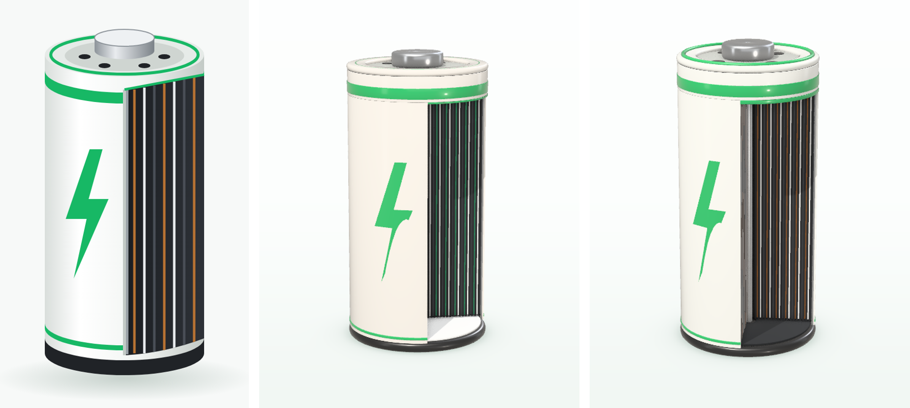

# Worked example: a lithium-ion cell icon into a 3D cutaway

A bench of [references/cutaway.md](../../references/cutaway.md): one icon of a lithium-ion cell rebuilt in three.js
from code, measured and graded against the icon, and stopped at the still gate after round 2, as the method says.
The film comes after the still is approved.

| File | What it is |
|---|---|
| [refs/R01-lithium-icon.svg](refs/R01-lithium-icon.svg) / `.png` | The one reference: a cell icon, a quarter cut away over the jelly roll |
| [CHECKLIST.md](CHECKLIST.md) | 11 lines for this picture, written and measured before any code |
| [lithium-cell/cell.js](lithium-cell/cell.js) | The cell: can, sleeve, jelly roll, mandrel, tabs, insulators, cap stack, each its own group with an anchor, and `pose()` for the teardown |
| [lithium-cell/main.js](lithium-cell/main.js) | The page and the hero camera on the cutaway runtime |
| [lithium-cell/measure.py](lithium-cell/measure.py) | Dark share and h/w inside the subject's box, reference against still (`--selftest`; needs Pillow, numpy) |
| [shots/](shots) | The round 2 page still, the reference \| R1 \| R2 stack, and the stack at 900 px |

## Run it

```
npx skills add Nyxera0x/cutaway -g -a claude-code      # then npm install + npx playwright install chromium in it
node "$SKILL_DIR/sims/build.mjs" ./lithium-cell
node "$SKILL_DIR/sims/capture.mjs" lithium-cell --size 1600x900 --dpr 1.2 --still 1.0 --out cutaway-out/still.png
python lithium-cell/measure.py refs/R01-lithium-icon.png cutaway-out/still.png --crop 700,360,1180,1000
```

The crop is the cell's area in the 1920 x 1080 page still. Without it the page's haze and cards count as subject.

## The bench



| | Reference | Round 1 | Round 2 |
|---|---|---|---|
| h/w (± 5%) | 2.259 | 2.122 no | **2.254 yes** |
| Dark share (≥ 0.262) | 0.328 | 0.210 no (0.64) | **0.280 yes (0.85)** |

| # | Line | R1 | R2 |
|---|---|---|---|
| 1 | Silhouette, view, h/w | partial | yes |
| 2 | The cut: layered roll with depth | partial | partial: layers and copper read; window narrower than R01's half front, copper lines faint |
| 3 | Mandrel on the axis | partial | partial: the can wall's edge reads, the pin doesn't |
| 4 | Top: gasket, cap, 4 vents, button | partial | partial: gasket and button read; vents hidden at a true 16° view |
| 5 | Dark base ring, 0.04 of the height | yes | partial: thinner than R01's band |
| 6 | Green bands, green cut edge | partial | yes |
| 7 | The bolt | yes | partial: the tail thins on the curved wrap |
| 8 | Gloss white, two-layer wall | partial | partial: still cream; the studio lights are warm |
| 9 | Green only as lines | **no** | yes |
| 10 | Layered at 900 px | partial | partial |
| 11 | Dark share | **no** | yes |

**Gate:** round 2 is shown, and round 3 waits for the user's notes. The round 3 plan from the partials: widen the
window toward the front centre, thicken the copper foil, push the mandrel out of the roll, a taller base cup, and
turn only the lights green (`retint` on lights, not on the cell).

## What the bench found

- **The house green fights the picture.** The green look's `retint` turns every warm colour green, which here
  included the copper foil (round 1, line 9: no). The picture outranks the house style, so this cell skips `retint`
  and builds its accents green. The lights stayed warm as a result, which is why the shell reads cream (line 8).
- **An icon cheats the camera.** R01 shows the top as if from 20°+ and the sides as if from 10°; no single camera
  matches both. The measured lines (h/w, dark share) pass while the vents (line 4) don't show. Grade those lines as
  partial and say why. Don't move the camera until the measured lines break.
- **No close body.** None of the 3 examples (tarantula, piranha, wasp) is a cylinder with no limbs, so the film
  cannot be ported 1:1. The method says to flag this before starting, so it is flagged here: the film choreography
  is new work and will take more rounds.
- **macOS capture.** Upstream's `paths.mjs` only picks an ANGLE backend on Windows. On macOS the headless shell
  can't create a WebGL context and capture times out, for the examples too. Adding `--use-angle=metal` on darwin fixed
  it (GPU reported: ANGLE Metal, Apple M1). Sandboxed shells also block the GPU, so run capture unsandboxed.
- **Cost.** 2 rounds, one object, a still at 1600 x 900 per round. Of the 11 lines, 2 were measured and 9 graded by
  eye. The measurements caught both of the biggest misses (proportions, density) on their own.
