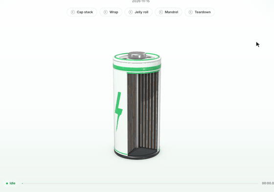

# Worked example: a lithium-ion cell icon into a 3D cutaway

A bench of [references/cutaway.md](../../references/cutaway.md): one icon of a lithium-ion cell rebuilt in three.js
from code, measured and graded against the icon, stopped at the still gate after round 2, then filmed at 60 fps with
a synced score once the user approved it.



| File | What it is |
|---|---|
| [refs/R01-lithium-icon.svg](refs/R01-lithium-icon.svg) / `.png` | The one reference: a cell icon, a quarter cut away over the jelly roll |
| [CHECKLIST.md](CHECKLIST.md) | 11 lines for this picture, written and measured before any code |
| [lithium-cell/cell.js](lithium-cell/cell.js) | The cell: can, sleeve, jelly roll, mandrel, tabs, insulators, cap stack, each its own group with an anchor, and `pose()` for the teardown |
| [lithium-cell/main.js](lithium-cell/main.js) | The page on the cutaway runtime: pills the cursor presses, labels, live cards |
| [lithium-cell/manual.js](lithium-cell/manual.js) | Manual mode on the live page: pills (or keys 1-5) toggle parts and combine, drag to orbit, scroll to zoom, double-click to reset, "Play film" hands back |
| [lithium-cell/tour.js](lithium-cell/tour.js) | The film as functions of time: open amounts, explode, one camera per beat, labels, card values |
| [lithium-cell/timeline.json](lithium-cell/timeline.json) | The beats in seconds; the picture and the score both read it |
| [lithium-cell/score.py](lithium-cell/score.py) | The score: a bed plus a click per press and an accent per moving part, −14 LUFS |
| [lithium-cell/measure.py](lithium-cell/measure.py) | Dark share and h/w inside the subject's box, reference against still (`--selftest`; needs Pillow, numpy) |
| [shots/](shots) | The round 2 still, the reference \| R1 \| R2 stack (and at 900 px), the film's beat sheet and GIF preview |

## Run it

```
npx skills add Nyxera0x/cutaway -g -a claude-code      # then npm install + npx playwright install chromium in it
node "$SKILL_DIR/sims/build.mjs" ./lithium-cell
open cutaway-out/dist/lithium-cell.html                # the deliverable: the film loops until you take over
node "$SKILL_DIR/sims/capture.mjs" lithium-cell --size 1600x900 --dpr 1.2 --still 1.0 --out cutaway-out/still.png
python lithium-cell/measure.py refs/R01-lithium-icon.png cutaway-out/still.png --crop 700,360,1180,1000
```

The crop is the cell's area in the 1920 x 1080 page still. Without it the page's haze and cards count as subject.

## The bench


| | Reference | Round 1 | Round 2 |
|---|---|---|---|
| h/w (± 5%) | 2.259 | 2.122 no | **2.254 yes** |
| Dark share (≥ 0.262) | 0.328 | 0.210 no (0.64) | **0.280 yes (0.85)** |

| # | Line | R1 | R2 |
|---|---|---|---|
| 1 | Silhouette, view, h/w | partial | yes |
| 2 | The cut: layered roll with depth | partial | partial: layers and copper read; window narrower than R01's half front, copper lines faint |
| 3 | Mandrel on the axis | partial | partial: the can wall's edge reads, the pin doesn't |
| 4 | Top: gasket, cap, 4 vents, button | partial | partial: gasket and button read; vents hidden at a true 16° view |
| 5 | Dark base ring, 0.04 of the height | yes | partial: thinner than R01's band |
| 6 | Green bands, green cut edge | partial | yes |
| 7 | The bolt | yes | partial: the tail thins on the curved wrap |
| 8 | Gloss white, two-layer wall | partial | partial: still cream; the studio lights are warm |
| 9 | Green only as lines | **no** | yes |
| 10 | Layered at 900 px | partial | partial |
| 11 | Dark share | **no** | yes |

**Gate:** round 2 was shown and approved as is. The partials above are still open (window width, copper weight,
the pin, the base band, the cream shell). The lights are now turned green, which cools the shell a little.

## The film

18 s, 1920 x 1080 at 60 fps, rendered frame by frame (1,080 frames in 75 s on an M1), score muxed. Beats every 2.5 s:

| t | Beat | Camera | What moves |
|---|---|---|---|
| 0 | Hero | front 3/4, 16° up | turntable drift; frame 0 already moving |
| 2.5 | Cap stack | from above, 40° | button, PTC ring, vent disc and gasket lift; top insulator follows |
| 5.0 | Wrap | low from the left | the sleeve loosens and rides up off the steel can |
| 7.5 | Jelly roll | into the cut, 22° | 18 layers telescope, inner first; the cap stays up |
| 10.0 | Mandrel | from the back left, 28° | the pin draws up through the open cap |
| 12.5 | Teardown | wide, 13° | the cell lies down in the air, the stack spreads along its axis, one turn on the axis |
| 15.3 | Reassembly | | everything seats; 3 clicks in the score |
| 16.4 | Exit | hero again | |

Every move runs along the cell's axis, so nothing passes through anything: the first explode slid the wrap and can
sideways through the roll and was replaced before rendering. The sheet of the final video is
[shots/film-beats.png](shots/film-beats.png) (0.2 s after each press, so the cameras are mid-move).

```
TL=lithium-cell/timeline.json python "$SKILL_DIR/run_sfx.py" lithium-cell/score.py
node "$SKILL_DIR/sims/capture.mjs" lithium-cell --size 1600x900 --dpr 1.2 --out cutaway-out/lithium-silent.mp4
ffmpeg -y -i cutaway-out/lithium-silent.mp4 -i cutaway-out/lithium-score.wav -map 0:v -map 1:a -c:v copy \
  -c:a aac -b:a 256k -shortest -movflags +faststart cutaway-out/lithium-cutaway.mp4
```

The MP4 (7 MB) is not committed; the commands above rebuild it.

## What the bench found

- **The house green fights the picture.** The green look's `retint` turns every warm colour green, which here
  included the copper foil (round 1, line 9: no). The picture outranks the house style, so the cell skips `retint`
  and builds its accents green; only the lights are retinted.
- **A still-only page looks broken.** The round 2 page held one pose with dead buttons, and the first reaction to it
  was "stuck, not working". When a still page is shown to anyone, say it is the gate, or show the stack image instead.
- **An icon cheats the camera.** R01 shows the top as if from 20°+ and the sides as if from 10°; no single camera
  matches both. The measured lines (h/w, dark share) pass while the vents (line 4) don't show. Grade those lines as
  partial and say why. Don't move the camera until the measured lines break.
- **No close body.** None of the 3 examples (tarantula, piranha, wasp) is a cylinder with no limbs, so the film
  cannot be ported 1:1. The method says to flag this before starting, so it is flagged here: the film choreography
  is new work and will take more rounds.
- **macOS capture.** Upstream's `paths.mjs` only picks an ANGLE backend on Windows. On macOS the headless shell
  can't create a WebGL context and capture times out, for the examples too. Adding `--use-angle=metal` on darwin fixed
  it (GPU reported: ANGLE Metal, Apple M1). Sandboxed shells also block the GPU, so run capture unsandboxed.
- **Cost.** 2 still rounds and 3 film review passes, one object. Of the 11 lines, 2 were measured and 9 graded by
  eye. The measurements caught both of the biggest misses (proportions, density) on their own.
