<p align="center"></p>

# design

Design toolkit, one skill with sub-skills.

| Sub-skill | What it does |
|---|---|
| [`core`](core/SKILL.md) | The principles the others share: composition, interface writing, a quality baseline, a taste pass, a reference-first cook loop scored by a fresh critic, and a picture-to-3D cutaway method |
| [`flow`](flow/README.md) | Real screens into Figma with their flowchart beside them, bound to the file's variables and text styles, through a containerized Figma MCP bridge |
| [`banner-design`](banner-design/SKILL.md) | Banners with the brand on one side and four steps of what the product does: exact platform sizes, 22 art directions, an SVG build and a bench (crop, contrast, phone width, file size) |
| [`thumbnail-keyart`](thumbnail-keyart/SKILL.md) | Game thumbnails and key art that show what the game is, what you do and the goal: a TOON brief (game read, anchors, prompt, variants), art without text, a live title, Roblox's bottom band and 3 MB limit in the bench, and a vision model that reads it back blind |

The agent's instructions are in [SKILL.md](SKILL.md).

```
npx skills@latest add th3r-dev/th3-skills --skill design
```

Merges the former top-level `design-core` and `design-flow` skills; their sub-skill names stay `design-core` and `design-flow`.
