# th3-skills social preview

The repo's GitHub social preview (1280 × 640): the ten skills as four jobs (Design, Build, Test,
Ship), every layout from [layouts.md](../../references/layouts.md) in the three preset styles.

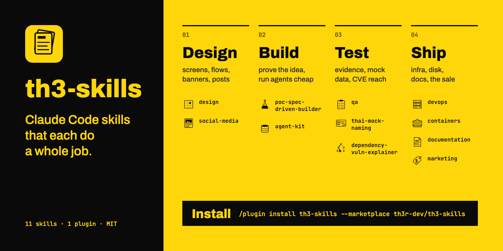

| | flat | dark | minimal |
|---|---|---|---|
| **columns** |  | 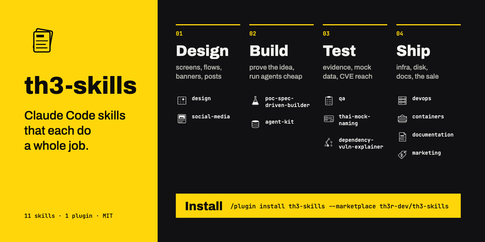 | 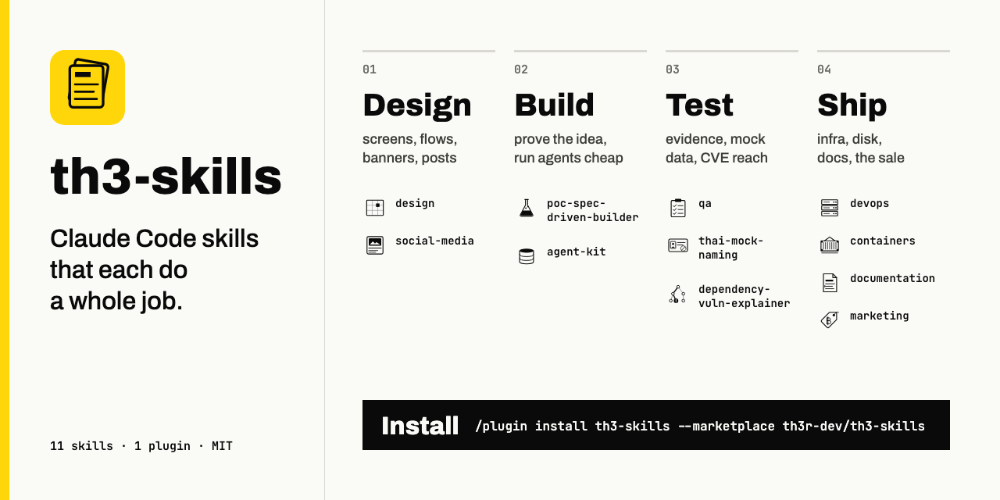 |
| **rail** | 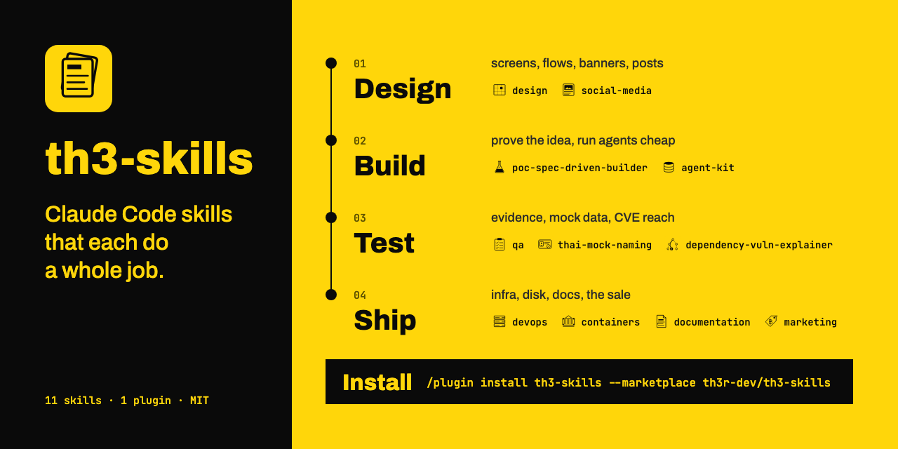 | 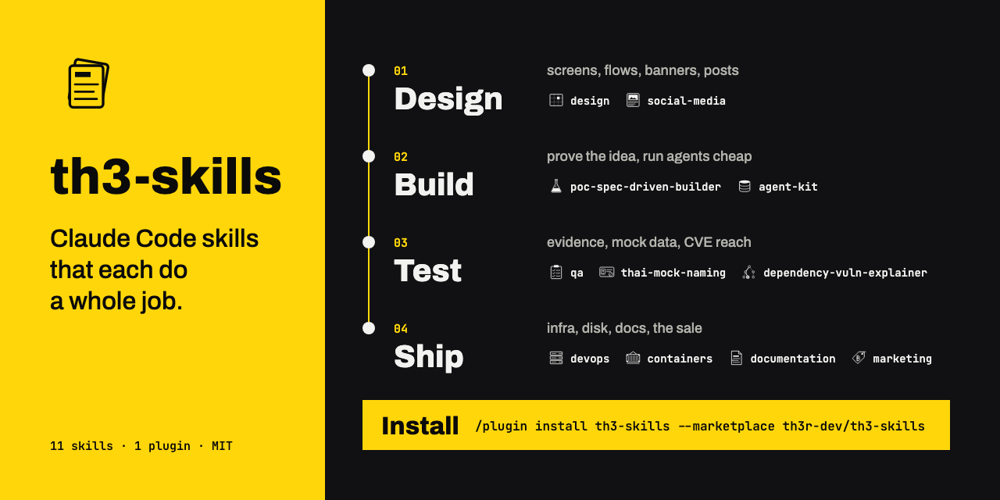 | 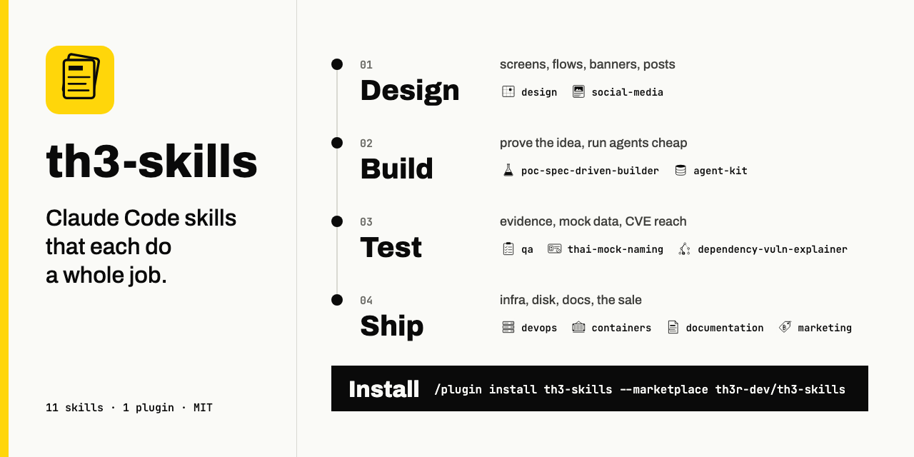 |
| **stairs** | 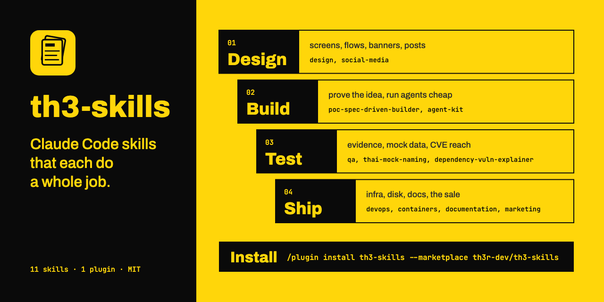 | 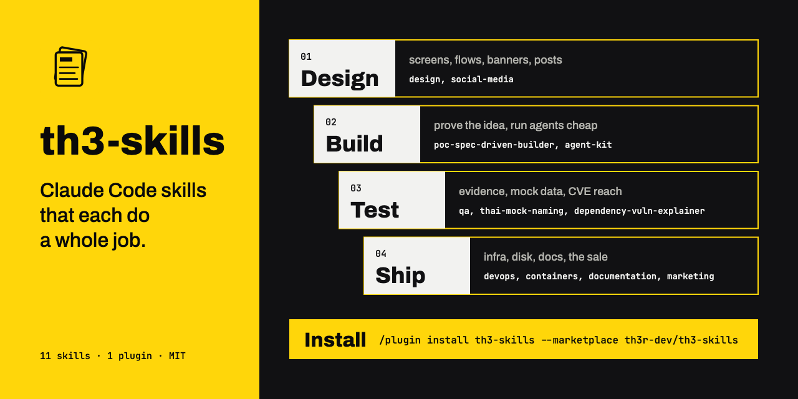 | 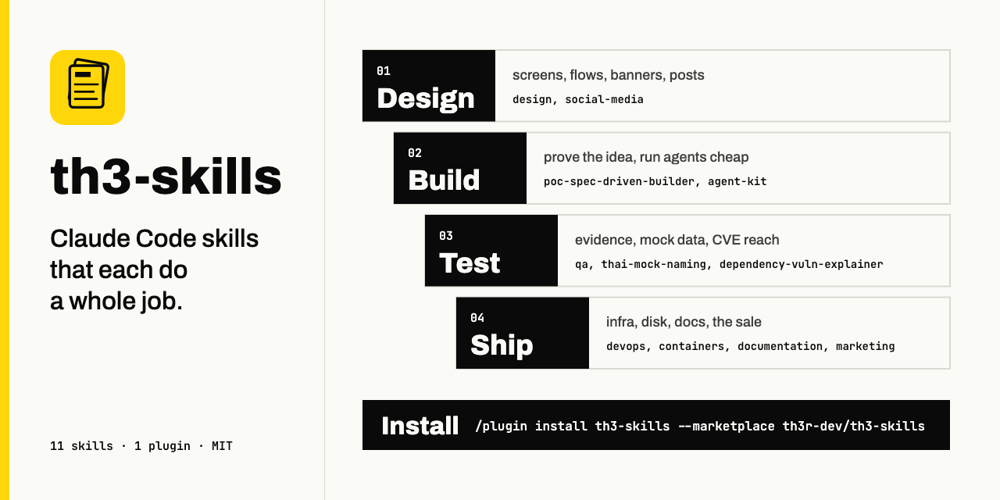 |
| **bento** | 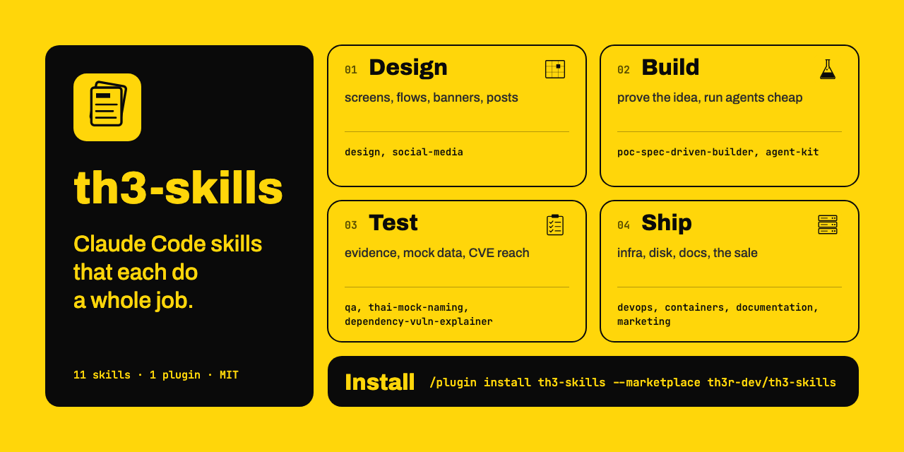 | 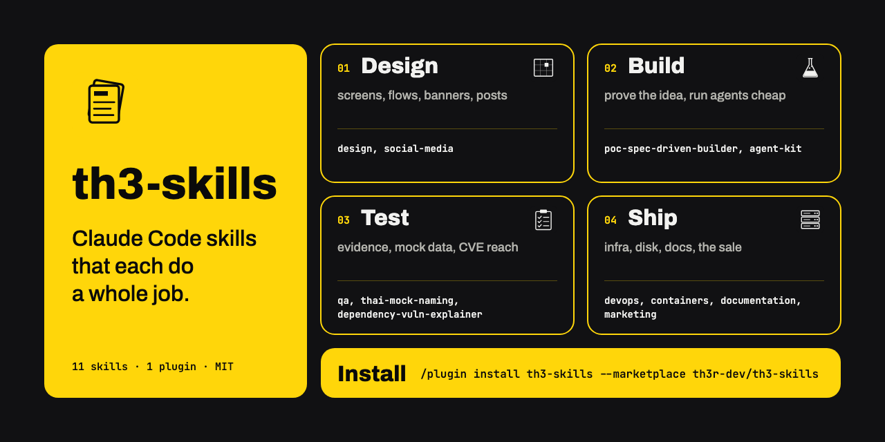 | 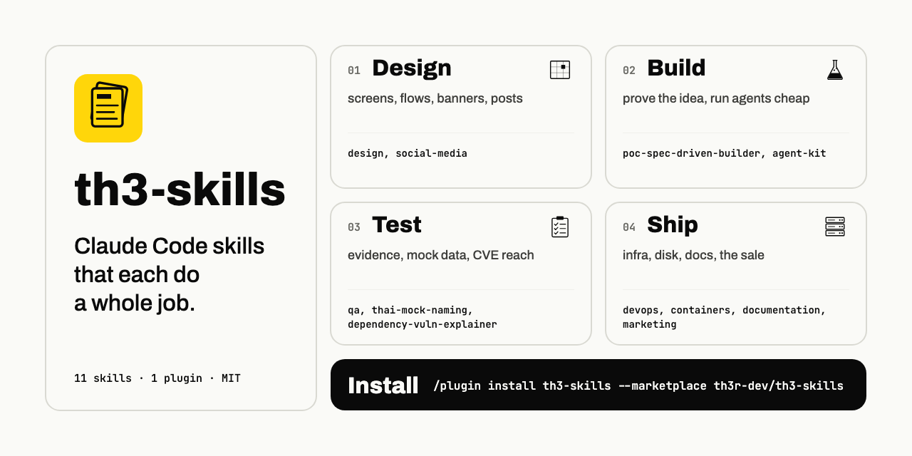 |

Everything comes from one spec, [th3-skills.banner.json](th3-skills.banner.json): copy, the skills'
own icons, the variant list.

```
uv run ../../scripts/banner.py th3-skills.banner.json          # 12 SVGs
for f in *-1280x640.svg; do uv run ../../scripts/bench.py $f; done
```

## Bench

All 12 pass. Worst contrast per style: flat 5.54:1, dark 9.05:1, minimal 5.12:1 (the step
numbers and secondary lines); core text 10.0px at a 400px phone card; PNGs 70-74 KB.

How it got there, on the columns-flat original:

1. Failed: the promise at 26px and the CTA at 22px came out at 8px and 7px on a phone card,
   under the 32px headline minimum. Widened the brand side to 32.5%, set both at 32px, moved the
   copyable command to the support zone.
2. Added dark and minimal: tokens only, same grid.
3. Added rail, stairs and bento from the layout research. Stairs' CTA ran out of room indented a
   fourth time, so it became the full-width floor; bento's tiles had dead lower halves, so the
   skill list moved to each tile's foot with one divider height for the grid.

Grayscale and spelling were checked by eye. My pick is columns-flat, because it is the repo's
own system. To use one, upload its `.png` under Settings → Social preview.
