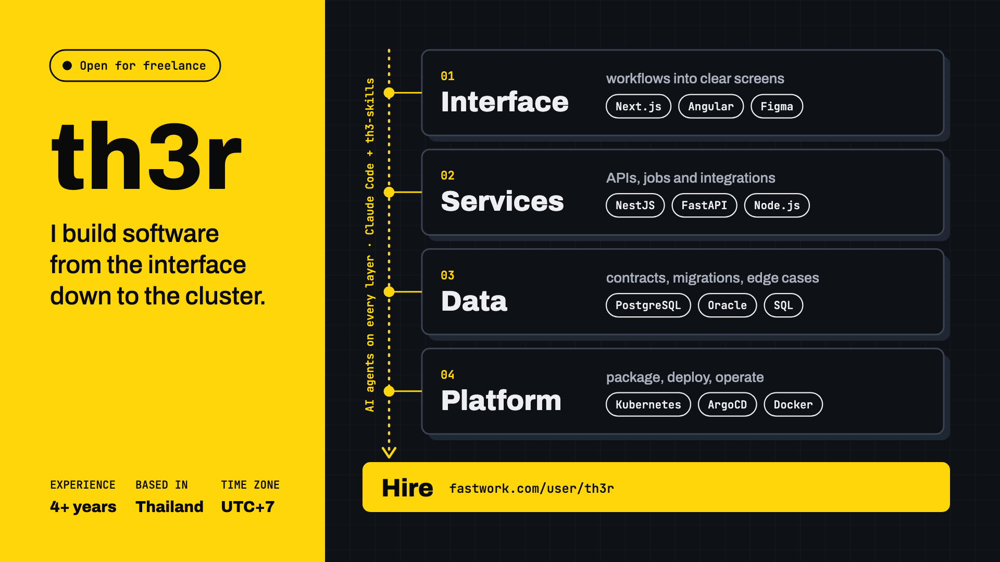
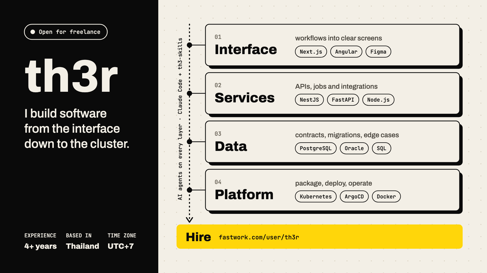
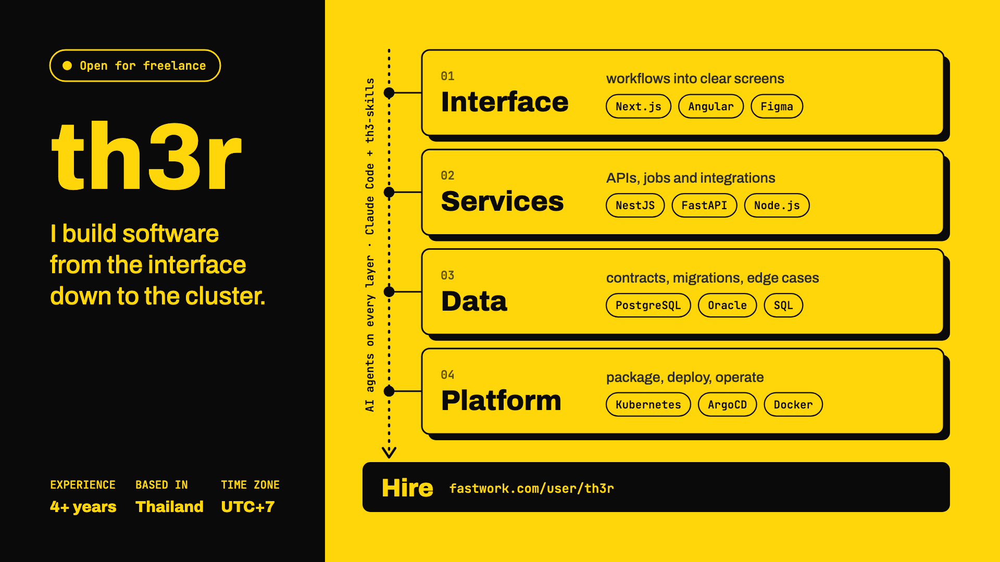

# th3r: first Fastwork post

A freelancer's first post on Fastwork, 1920 × 1080. Fastwork publishes no size; its service pages
show images in a 16:9 box (840 × 473, served at 960 × 540), so this is that ratio at 2× for a sharp
upload.

| blueprint | paper | flat |
|---|---|---|
|  |  |  |

The copy comes from the th3r-dev GitHub profile README: the promise ("from the interface down to
the cluster") and its four layers with their daily tools.

The layout is `stack` ([layouts.md](../../references/layouts.md#stack)). The layers read as an
architecture diagram, and a request runs down through them into the Hire bar, which is the story
the GitHub hero tells. The label on the request line, "AI agents on every layer · Claude Code +
th3-skills", is the README's "Working with AI agents" section in one line (`through` in the spec).

The `blueprint` and `paper` styles are defined in the spec, so they travel with it.

The brand side carries an "Open for freelance" badge (after Bruno Cisco's availability bar) and
labelled facts (after Oz Gultekin's WHAT / WHERE row): 4+ years from the Fastwork bio, Thailand and
UTC+7 from the GitHub README. Both sit in the support zone, read after the name.

```
uv run ../../scripts/banner.py th3r.banner.json
for f in stack-*-1920x1080.svg; do uv run ../../scripts/bench.py $f; done
```

## Bench

All three pass at 1920 × 1080 (96px edge band): worst contrast blueprint 8.74:1, paper 5.04:1,
flat 5.54:1; core text 10.0px at a 400px phone card; PNGs 132-143 KB.

The first run failed: with no logo the name moved up into the edge band at 120px. The renderer now
places a mark-less name by its font's ascent box, which the bench measures.

English only: the fonts have no Thai glyphs. A Thai version needs a Thai font (for example Noto
Sans Thai, OFL) added to the core fonts first.
