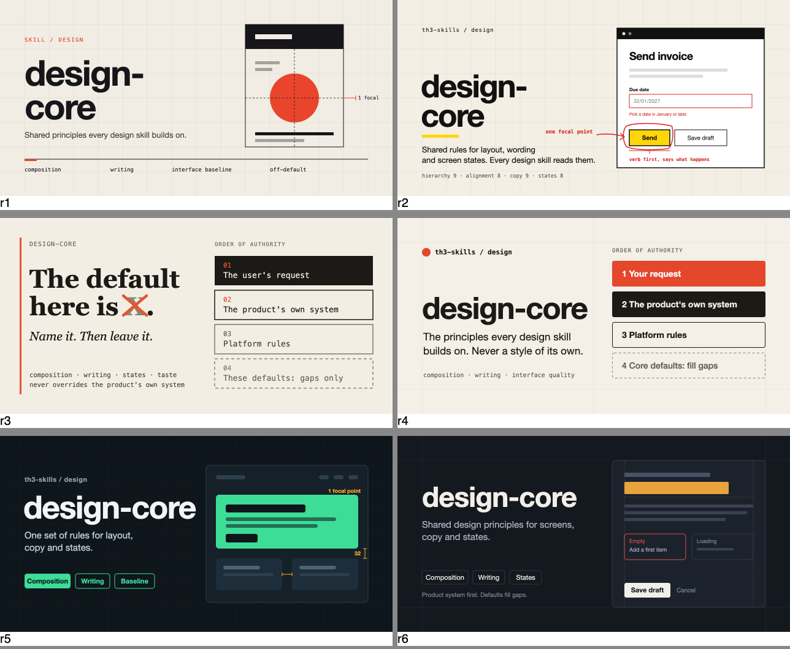
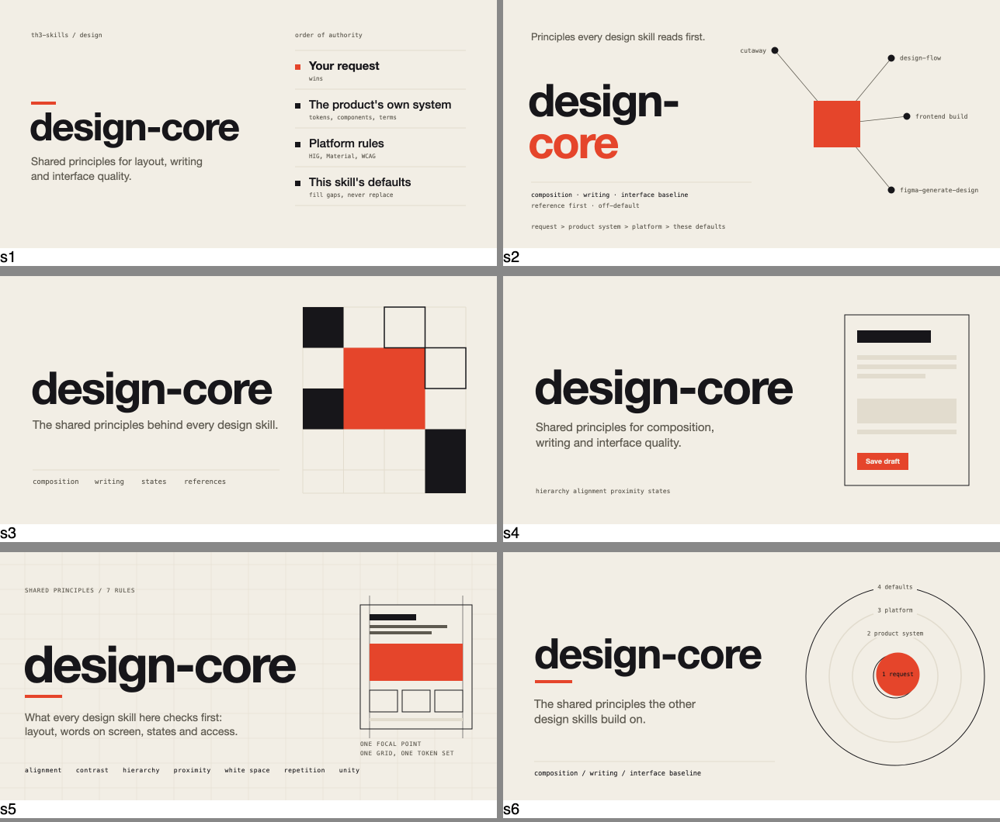

# Banner bench: design-core with and without off-default

Does [`off-default.md`](../../references/off-default.md) change what agents design? Run 2026-11-18 by
the method in design-flow's bench loop: one request, agents that don't know they are being
compared, a judge that sees only shuffled letters.

**Result.** With the palette left open, the off-default runs scored higher (41.7 vs 36.3 of 60) and
were less generic (6.3 vs 3.3 of 10), but all three landed on the same cream-and-red look. With the
palette fixed, the totals tie (37.7 vs 38.3): what remains is **fit**, the banner saying what
design-core is (7.0 vs 5.0). Neither version changed the layout: all 12 banners put the name left
and a picture right. Three runs per side, so a direction, not proof.

## Method

- **Request**, the same for every run: *design a GitHub banner, 1280×640, that represents the
  design-core skill; a self-contained SVG under 200 KB*, with the skill folder as `skill/` and
  "read `skill/SKILL.md` first and follow it". No word like bench, test or compare.
- **Versions**: `dev` is design-core at `origin/dev`; `off-default` is this branch. Run folders
  were shuffled, so the folder name gave nothing away.
- **Agents**: Sonnet, one per run, rendering with [`src/render_svg.py`](src/render_svg.py) and
  looking at full and icon size.
- **Judge**: a fresh Sonnet agent with only the PNGs under random letters and a one-paragraph
  description of design-core. It scored six 0–10 rows: hierarchy, alignment and space,
  legibility, copy, fit, distinctness.
- **Measured**: antialgorithm's `check.py` (text that is clipped, covered, low-contrast or small),
  and the spread between each version's runs ([`src/spread.py`](src/spread.py): thumbnail pixel
  difference and hue-histogram distance; higher means the runs differ more).

## Round 1: palette open



| Run | Version | Idea | Total /60 | Distinct /10 |
|---|---|---|---|---|
| r3 | off-default | "The default here is ~~X~~" beside the order of authority | **48** | 8 |
| r4 | dev | order of authority as stacked bars | 43 | 4 |
| r2 | off-default | a form screen marked up in red pen | 41 | 6 |
| r5 | dev | dark ground, green wireframe, chips | 36 | 3 |
| r1 | off-default | wireframe with one red focal circle | 36 | 5 |
| r6 | dev | dark ground, amber wireframe, state cards | 30 | 3 |

| | dev | off-default |
|---|---|---|
| Mean total | 36.3 | **41.7** |
| Mean distinctness | 3.3 | **6.3** |
| Spread, pixel / hue | 0.498 / 0.903 | 0.114 / 0.277 |

The judge called both dark dev runs "the default AI dev-tool banner". All three off-default runs
chose a cream ground and a red accent, which `off-default.md` itself lists under "the escape
becomes a default". No run used `seed.py`, correctly: the request named a real subject.

## Round 2: palette fixed

Every run got the same theme: ground `#F2EEE5`, ink `#17161A`, one accent `#E5452B`, secondary
`#5E5A50`, hairlines `#E2DCCE`, Helvetica Neue and Menlo, flat. All six stayed inside it.



| Run | Version | Idea | Total /60 | Fit /10 | Distinct /10 |
|---|---|---|---|---|---|
| s1 | dev | order of authority as a ruled list | **49** | 8 | 6 |
| s6 | off-default | order of authority as rings around a red core | 42 | 8 | 5 |
| s2 | off-default | a red "core" square with spokes to the skills built on it | 39 | 7 | 5 |
| s3 | dev | abstract block grid, one red block | 35 | 4 | 3 |
| s5 | off-default | wireframe on a blueprint grid | 32 | 6 | 3 |
| s4 | dev | grey wireframe card, red button | 31 | 3 | 2 |

| | dev | off-default |
|---|---|---|
| Mean total | 38.3 | 37.7 |
| Mean fit | 5.0 | **7.0** |
| Mean distinctness | 3.7 | 4.3 |
| Spread, pixel / hue | 0.088 / 0.089 | 0.063 / 0.058 |

## What it says about the skill

- Round 1's gain was mostly the palette: off-default steered away from the dark dev-tool look,
  then converged on its own escape.
- What holds in both rounds is subject: off-default banners are about design-core more often. The
  two emptiest banners (s3, s4) are both `dev`.
- The layout default (name left, picture right) is untouched. The next change worth measuring is
  naming it in `off-default.md` as the palette is named, then rerunning round 2's off-default side.
- The order of authority is the strongest idea either way: it won both rounds (r3, s1).

## Rerun

```bash
python src/render_svg.py round1/r1-off-default.svg round1/r1-off-default.png   # any Python with Playwright + Chromium
uv run src/spread.py round1
```

`check.py` comes from [mankidev/antialgorithm@8706a2d](https://github.com/mankidev/antialgorithm/blob/8706a2d49511954d0d092f732eb5853497ad25fc/scripts/check.py)
(needs numpy, Pillow and `rsvg-convert` or cairosvg). The sheets are the same renders the judge
scored, laid side by side.
