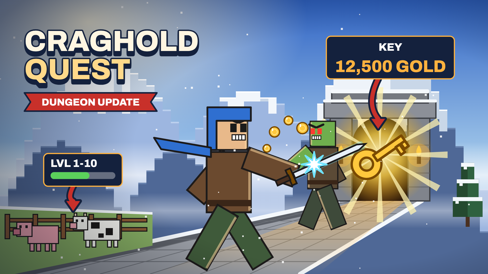
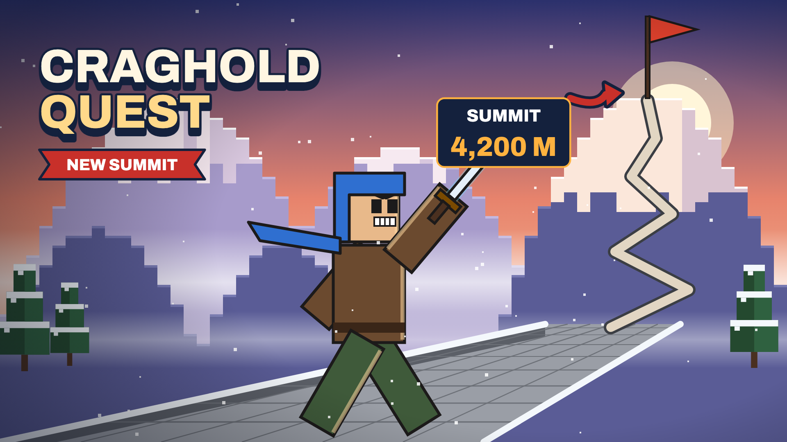

# Craghold: a two-variant Roblox thumbnail

A mock game, made up for this example: a blocky adventure on a snow mountain where you fight up
from the farm, level up, earn gold and buy the dungeon key. The bench image it was measured
against was a painted "dungeon update" thumbnail: a hero mid-run, the first enemy with a level
bar, a guarded gate and a glowing key with its price.

| v3 loop (progression) | dungeon (mastery and reward) | summit (exploration) |
|---|---|---|
|  |  |  |

The **loop** variant is the one that explains the game: left to right it is the core loop, level up
on the farm (LVL 1-10), fight monsters for gold, buy the key to the dungeon. It follows the bench's
grammar in vector, not its painted look.

**Art path: vector.** The image model (Gemini) answered 429, free tier, limit 0, so the scenes are
[build_art.py](build_art.py): blocky ranges snapped to a voxel grid, snow only above a snow line and
shaded on slopes facing away from the sun, haze with soft stops, and the sword placed from the arm's own
rotation. The brief's `prompt` and `negative` are ready for an AI render.

The brief, [craghold.keyart.toon](craghold.keyart.toon), holds the game read, the five anchors, the
palette, the callouts (each pinned to its prop with an arrow, and to its variant) and the two variants.
The summit variant has its own `goal` and `loop`, since it targets exploration.

```
python3 build_art.py
uv run ../../../banner-design/scripts/banner.py craghold.keyart.toon
for f in keyart-*-1920x1080.svg; do uv run ../../../banner-design/scripts/bench.py $f --bottom 120 --max-kb 3000; done
uv run ../../scripts/critic.py craghold.keyart.toon keyart-dungeon-craghold-1920x1080-400.png
```

## Bench

| Variant | Worst contrast | PNG 1× | Bottom band | Result |
|---|---|---|---|---|
| loop | 5.37:1 (ribbon) | 866 KB | clear | pass |
| dungeon | 5.37:1 (ribbon) | 884 KB | clear | pass |
| summit | 5.37:1 (ribbon) | 633 KB | clear | pass |

## Critic (deepseek-v4.1-flash via Tokenme, 400 px PNG, 3 runs each)

| Variant | Runs passing | is | loop | goal | Result |
|---|---|---|---|---|---|
| summit | 3/3 | 1, 1, 1 | 2, 2, 2 | 1, 2, 2 | pass |
| dungeon | 1/3 | 1, 1, 1 | 1, 1, 1 | 1, 1, 2 | fail |
| loop | 0/3 | 1, 1, 1 | 1, 1, 1 | 1, 1, 1 | fail |

What is still wrong:

- **`is` scores 1 everywhere.** The read is "a blocky action RPG / dungeon crawler"; the snow-mountain
  world never makes it into the sentence.
- **The farm's "level up" doesn't come through as an idea.** The critic reads "LVL 1-10" as text
  but describes the loop as "fight enemies, collect gold"; the judge wants "level up".
- **The goal reads as "get the key"**, not "buy the key and open the gate".

The reads look right to a person ("fight enemies with a sword, collect gold coins, unlock the
glowing key"); the judge is strict about the brief's exact beats. Next: a second judge model to
check that, or brief lines a thumbnail can actually show.

## How it got here

1. First build: the title and ribbon sat on the hero's face, the sword floated beside the hand, and
   snow flooded the far range. Fixed with a smaller, lower hero, a hand computed from the arm, and a
   snow line. The summit's flag ran off the top edge; fixed with a lower peak and a stepped trail.
2. The first critic: the summit was scored against the dungeon's goal, so variants got their own
   `goal`. The snow line was raised.
3. A review against the bench (a Minecraft map's dungeon-update thumbnail and its video) and
   2025-2026 thumbnail trends. Applied:
   - a face that reacts: big eyes, angry brows, gritted teeth; the hero 1.4× larger
   - the title moved top-left and capped (`title_at`, `title_max`)
   - a near-black arch so the key is the brightest thing; warm light spilling down the bridge
   - snow on the pines, the lintel and the kerbs, shaded snow sides, falling flecks
   - the enemy between the hero and the gate, facing him, with a hit spark and coins
   - red arrows from each callout to its prop; callout text 42 px at 1920
   - the critic fails when the eye lands on the title
4. With those changes one critic run put the eye on the key, but the next three runs put it back
   on the title in two. One sample is noise, so the critic now runs three times and takes the majority.
5. Version 2 and 3, vector only (the bench's painted look is not the target):
   - v2: a cream title (`title2` token) and richer rock colours on both variants; the summit rebuilt as
     its own moment: sunrise behind the peak, a switchback path cut up the slope, the hero pointing
     his sword at the flag, the plate in open sky with an arrow.
   - v3: a new `loop` variant that explains the core loop left to right, with the farm pen, voxel pig
     and cow under LVL 1-10. A callout's `only` can now name several variants.
   - The title still came first in 9 of 9 runs, so the critic was run on the bench thumbnail itself:
     the logo came first there too, 3 of 3. The focus rule was measuring the model, not the design;
     focus is reported again, not scored.
