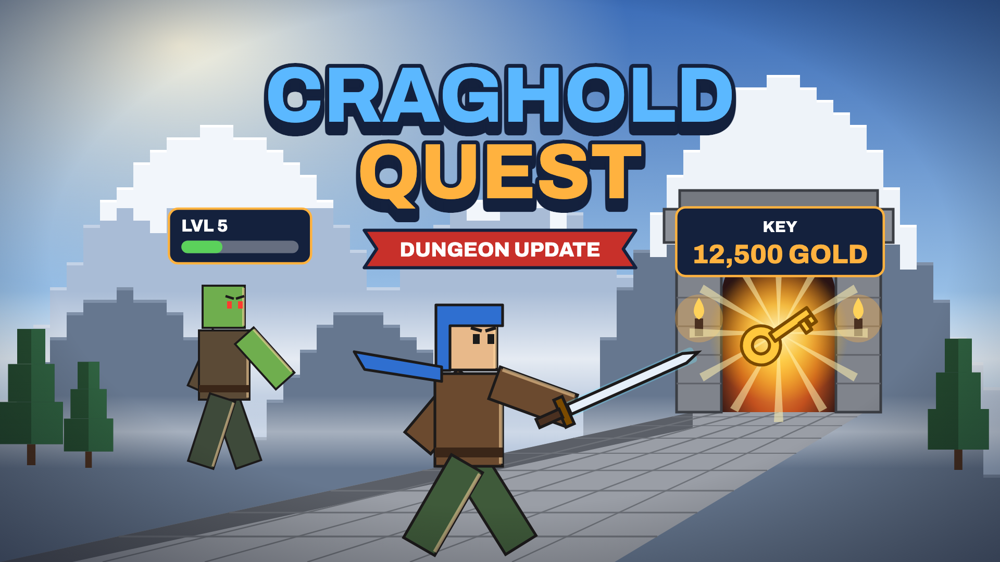

# Craghold: a two-variant Roblox thumbnail

A mock game, made up for this example: a blocky adventure on a snow mountain where you fight up
from the farm, level up, earn gold and buy the dungeon key. The bench image it was measured
against was a painted "dungeon update" thumbnail: a hero mid-run, the first enemy with a level
bar, a guarded gate and a glowing key with its price.

| dungeon (mastery and reward) | summit (exploration) |
|---|---|
|  |  |

**Art path: vector.** The image model (Gemini) answered 429, free tier, limit 0, so the scenes are
[build_art.py](build_art.py): blocky ranges snapped to a voxel grid, snow only above a snow line,
haze with soft stops, and the sword placed from the arm's own rotation. An AI render would carry
more light and texture; the brief's `prompt` and `negative` are ready for one.

The brief, [craghold.keyart.toon](craghold.keyart.toon), holds the game read, the five anchors,
the palette, the callouts (each pinned to its prop and its variant) and the two variants. The
summit variant has its own `goal`, since it targets a different motivation.

```
python3 build_art.py
uv run ../../../banner-design/scripts/banner.py craghold.keyart.toon
for f in keyart-*-1920x1080.svg; do uv run ../../../banner-design/scripts/bench.py $f --bottom 120 --max-kb 3000; done
uv run ../../scripts/critic.py craghold.keyart.toon keyart-dungeon-craghold-1920x1080-400.png
```

## Bench

| Variant | Worst contrast | Smallest core text at 400 px | PNG 1× | Bottom band | Result |
|---|---|---|---|---|---|
| dungeon | 5.37:1 (ribbon) | 35.0 px | 784 KB | clear | pass |
| summit | 5.37:1 (ribbon) | 35.0 px | 697 KB | clear | pass |

## Critic (deepseek-v4.1-flash via Tokenme, the 400 px PNG)

| Variant | is | loop | goal | Text read back | Eye lands on | Result |
|---|---|---|---|---|---|---|
| dungeon | 1 | 1 | 2 | all 6 strings | the title | pass, 4/6 |
| summit | 1 | 1 | 2 | all 5 strings | the title | pass, 4/6 |

What the critic changed:

- The first summit run scored the goal 0: the brief held one goal (the key) for both variants.
  Variants now take their own `goal`.
- The first dungeon run scored 3/6: the snow line sat so low the mountain didn't read as snowy.
  Raising it fixed the goal read, but `is` still scores 1: the critic calls it a dungeon crawler
  and the snow world doesn't come through at 400 px.
- In both, the eye lands on the title before the key. Open item: a smaller title or a brighter key
  for the next pass.

## Earlier passes

1. The title and ribbon sat on the hero's face, the sword floated beside the hand, and snow
   flooded the far range. Fixed with a smaller, lower hero, a hand position computed from the arm,
   and a snow line.
2. The summit's flag ran off the top edge. Fixed by lowering the peak and climbing to it with a
   stepped trail.
