<p align="center"></p>

# devops

Infra changes, in a fixed order. Three sub-skills: change, release-scope, network-diagram.

The agent's instructions are in [SKILL.md](SKILL.md).

```
npx skills@latest add th3r-dev/th3-skills --skill devops
```
