<p align="center"></p>

# doc-style-builder

Any work product, documented one way. Seven skeletons, one house theme, PDF + DOCX from one Markdown file.

The agent's instructions are in [SKILL.md](SKILL.md).

```
npx skills@latest add th3r-dev/th3-skills --skill doc-style-builder
```
