<p align="center"></p>

# documentation

Documentation toolkit, one skill with sub-skills.

| Sub-skill | What it does |
|---|---|
| [`doc-style`](doc-style/SKILL.md) | Documents any work product (API, deploy, system, release) in one house style: seven document skeletons, a TH Sarabun theme with change highlighting, and Markdown → PDF + DOCX in one command |
| [`pdf-operations`](pdf-operations/SKILL.md) | PDF manipulation with `pdf-lib`: merging, splitting, extracting/reordering, rotating pages and drawing overlays through the existing pipeline |

The agent's instructions are in [SKILL.md](SKILL.md).

```
npx skills@latest add th3r-dev/th3-skills --skill documentation
```
