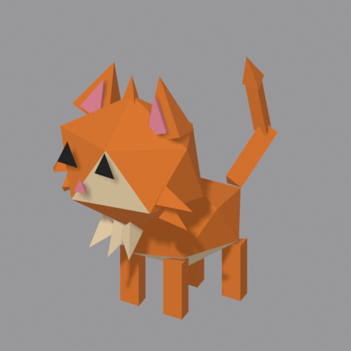
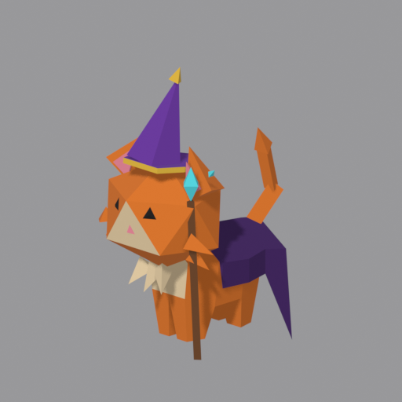
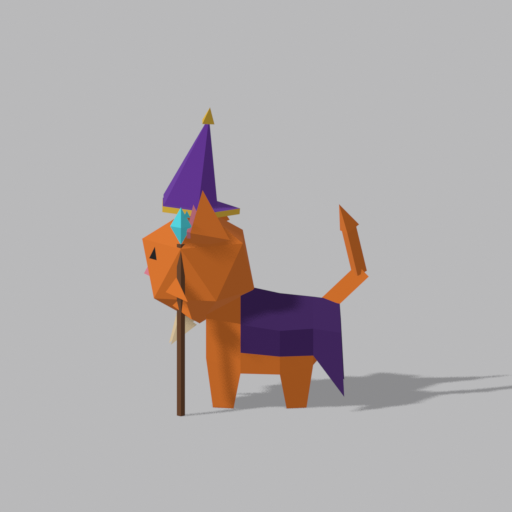
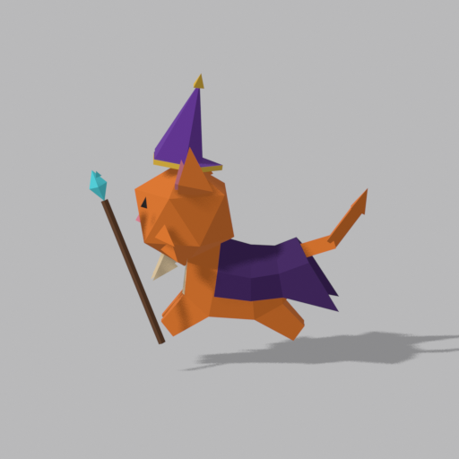
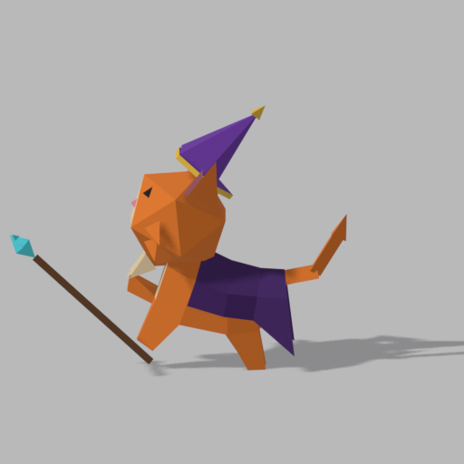
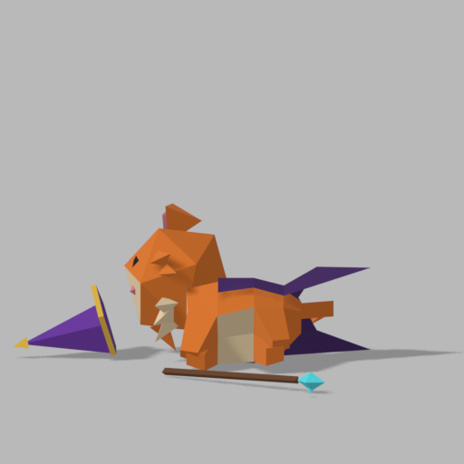
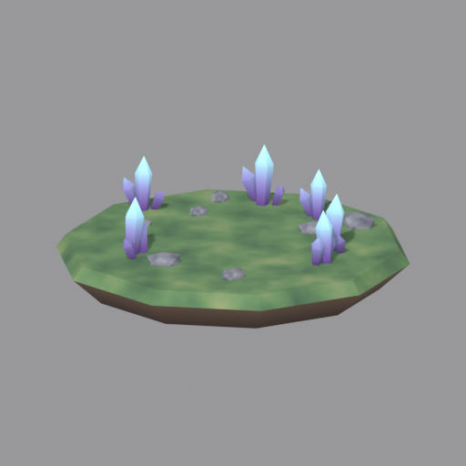
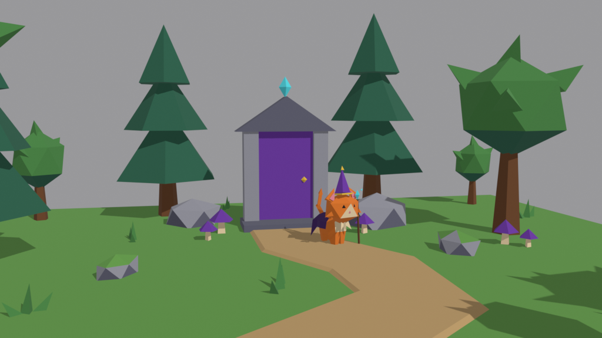

# Worked cases: the reference set

Five cases. The first four were built headless, each a Python script you can rerun, with a bench
case that scores it and renders. The fifth, `dungeon-key/`, was made in the open Blender through the
MCP add-on: its `.blend` is the source and `steps/` records each call. Read this before starting a new
asset of the same kind: copy the closest case's approach, not its numbers.

| Case | Prompt (as typed) | Result | Bench | Shows how to |
|---|---|---|---|---|
| [`dungeon-key/`](dungeon-key/README.md) | "an game-dev model work need working with blender not just a pyscript" | 648 triangles, 1 closed mesh, QA pass (roblox), `mesh_check` exit 0 | asset-qa + mesh_check | work live in Blender: a look after every stage, blender-skills' QA gate, its Roblox export presets |
| [`lowpoly-cat/`](#lowpoly-cat) | "Create an cat furry charactor which lowest polygon" | 188 triangles, 16 parts | 9/9 | design from a reference board; colour by face, not by shape |
| [`wizard-cat/`](#wizard-cat) | "output is need wizard cat", then "need rework that caps … leg need blend it with body" | 292 triangles, 22 parts, 15-bone rig, 5 actions | 9/9 | dress a base model; take a review; rig and animate for Roblox |
| [`crystal-ground/`](#crystal-ground) | shading and geometry nodes work | 498 triangles, 3 parts, baked | 8/8 | scatter with Geometry Nodes, bake a procedural look |
| [`wizard-glade/`](#wizard-glade) | environment and studio theme work | 942 triangles placed from 10 kit pieces | 8/8 | build a scene as a kit, keep a house style |

Rebuild any case (Blender 5.3, headless), then score it:

```bash
blender -b --factory-startup --python examples/<case>/build_<case>.py -- --out examples/<case>
python scripts/bench_model.py benchmarks/<case>.toon examples/<case>/<model>.glb
```

The script names are `build_cat.py`, `build_wizard_cat.py`, `build_crystal_ground.py` and
`build_wizard_glade.py`. The cat's case file is `lowpoly-furry-cat.toon`, the wizard's
`lowpoly-wizard-cat.toon`.

## lowpoly-cat



The base character every other case builds on. `build_cat.py` is also the house kit: the palette
material, `paint`, `solid`, `join`, `spike_toward`, `prism_toward`, `on_surface`, `render`.

| Build | Triangles | What changed, and what caught it |
|---|---|---|
| v1 | 168 | first pass from the prompt alone |
| v1.1 | 148 | **renders**: a belly hidden inside the body cost 20 triangles; a chest tuft floated |
| v3 | 128 | **reference board** (`lowpoly-cat/references.md`, 7 Sketchfab cats + Pinterest): character proportions, muzzle and belly as face colours, bigger eyes |
| v4 | 128 | **texturing references**: four materials became one over a 16 px palette |
| v5 | 188 | **user feedback**: legs grown from one lofted body mesh instead of separate posts; mirror-symmetric head; eyes and nose seated by ray cast |

## wizard-cat



The base cat dressed by `build_wizard_cat.py` (hat, brim with a gold rim, cloth cape, staff with
an octahedron crystal, a spark). Rigged by `rig_wizard_cat.py` (Fable 5.2 agent).

| Build | Triangles | What changed, and what caught it |
|---|---|---|
| v1 | 200 | first outfit; the hat tip was cut off in the render (camera now frames the model) |
| v2 | 224 | **review round 1 (5/10)**: the cape was lopsided and the body showed through; fur read as stubby arms; the clasp hid inside the head |
| v2 | 224 | **review round 2 (6/10)**: the staff crossed the face; the head was not mirror-symmetric |
| v3 | 292 | **user feedback**: the cape "like a block that was placed" became a cloth shell over the body's own sections; legs blended into the body |
| v3.1 | 292 | **rigging agent's renders**: the cape hem hung below the ground; clamped to z 0.12 |

Rig: 15 bones (Root, Hips, Spine, Chest, Neck, Head, Hat, four legs, two tail, Cape, Prop), one
skinned mesh, at most 2 influences per vertex. Actions at 24 fps:

| Idle 1–49 | Walk 1–25 | Run 1–17 | Attack 1–20 | Dead 1–30 |
|---|---|---|---|---|
|  |  |  |  |  |

Exports: `rig/wizard-cat-rigged.fbx` (all five) and `rig/wizard-cat-<Action>.fbx` (one each,
because Roblox's importer may read one take per file). Known flaw: in Dead's last pose the cape hem
stands up like a wing (one hem bone).

## crystal-ground



A tile for the cat to stand on. Crystals and rocks are scattered by one Geometry Nodes group from
a seed (`--seed`; [seed 11](crystal-ground/three-quarter-seed-11.png) is a different layout), the
modifier applied before export. Procedural materials (noise, ramps, emission toward the tips) are
baked to a 256 px colour map and a 128 px emission map; the export material is one Principled BSDF
over those two images. The first bake let crystal glow bleed onto the ground's rim: the bake
margin was wider than the gap between UV islands.

## wizard-glade



A 24 × 24 stud glade in the studio theme. Ten kit pieces (three trees, two rocks, mushroom, grass,
path, ground, a wizard's door) are each built once and exported once to `kit/<Piece>.fbx`;
`layout.json` places 35 copies, so Roblox uploads each piece once. The cat is the brightest thing
in frame and accents stay under a tenth of the surface (measured 1.8%), as `art-theme.md` asks.

## What the session taught (rules now in the references)

1. **References before the first vertex.** v1 of the cat was built from the prompt alone; the
   reference board changed its proportions and cut 20 triangles. (`SKILL.md` section 2)
2. **The bench measures, the renders judge.** Every check passed while the cape was lopsided and
   the hem was under the ground: only looking caught them. (`visual-review.md`)
3. **The builder does not score their own model.** A fresh reviewer found the lopsided cape the
   builder missed. Then re-measure the reviewer's claims: both rounds' numbers checked out, and
   one fact in the builder's own brief (the part count) was wrong. (`visual-review.md`)
4. **A test has to fit the shape.** A ray test written for a solid cape read a thin cloth shell
   backwards; for a shell, "poking through" means no hit above the body, not an even count.
5. **A shell must follow every section of what it covers.** A cape with fewer sections than the
   body cuts chords through the body's bulge.
6. **Library defaults differ from the editor's.** `bmesh.ops.extrude_face_region` keeps the source
   face; the editor's extrude removes it. Left in, the body was not closed (14 open edges).
7. **Colour by face before adding a shape.** Muzzle, belly and hat band are painted facets, at 0
   triangles; one palette material is one draw call. (`texturing.md`, `art-theme.md`)
8. **What leaves Blender is a mesh and images.** Node shaders are baked, Geometry Nodes applied,
   Blender lights stay in Blender. (`shading.md`, `geometry-nodes.md`, `environment.md`)
9. **Roblox's rig rules are checked on the re-imported FBX**, not in the scene that wrote it:
   rest rotation 0 and scale 1, root at the origin with no weights, at most 4 influences.
   (`rigging.md`)
10. **Nothing here is proven in Roblox Studio yet.** Imports, takes, instancing and emission are
    the next things to test there.
