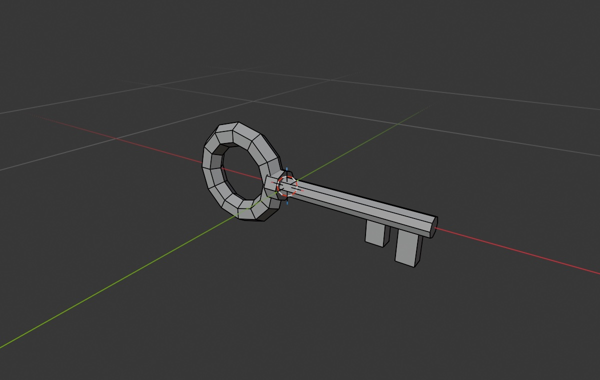
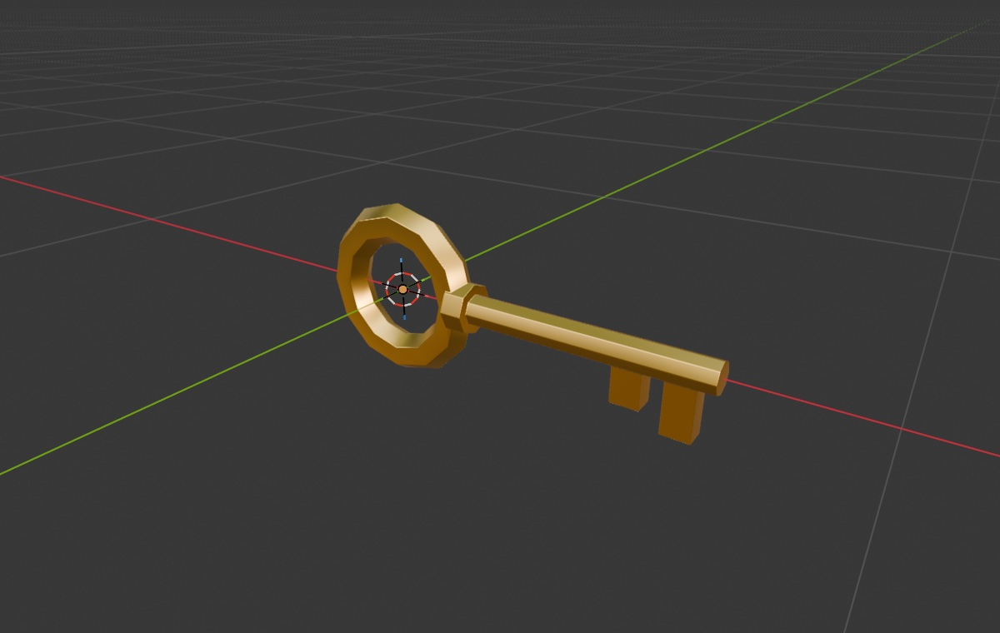
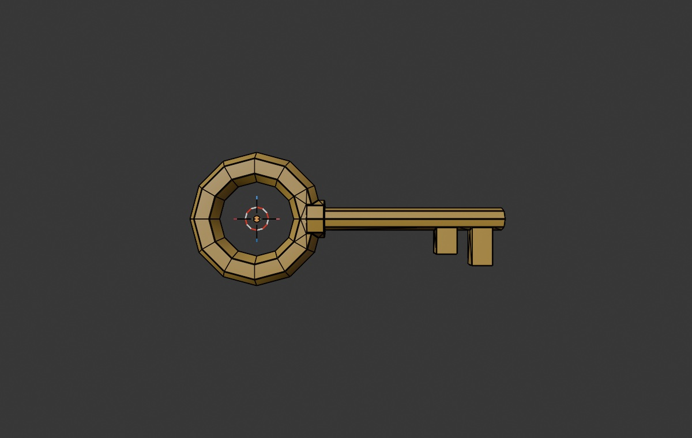

# Dungeon key: made in the open Blender

The gold key from Craghold (the mock game behind design's thumbnail-keyart and game-dev's design-ui),
as a Roblox MeshPart. It was built in a **running Blender 5.3 window**, through the Blender Lab MCP
add-on on port 9876, one stage per call, with a look at the viewport after each. Unlike the other
examples, it has no rebuild script: the `.blend` is the source and `steps/` records what was sent.

| Blockout | Finished (material) | Finished (wire, front) |
|---|---|---|
|  |  |  |

## Files

| File | What it is |
|---|---|
| `dungeon-key.blend` | the source: one `DungeonKey` scene and collection, the mesh with its live modifier stack (`Chamfer` bevel, `WeightedNormals`), material `KeyGold` |
| `dungeon-key.fbx` | Roblox, blender-skills preset `roblox` (FBX unit scale, modifiers applied, no leaf bones) |
| `dungeon-key.glb` | Roblox glTF, preset `roblox_gltf`; what `mesh_check.py` reads |
| `steps/01-08_*.py` | every call as sent, in order |
| `look/` | viewport renders of the 3D View taken during the session |

## The session

| Step | What it did | What the session showed |
|---|---|---|
| `env_report` (blender-skills core) | Blender 5.3.0, Metal GPU, not background, the MCP add-on enabled | a live window, not a background run |
| 01 scene | a `DungeonKey` scene and collection of its own | the person's scenes untouched |
| 02 blockout | bow (a 12×6 ring), collar, shaft, two teeth, sized in studs (0.28 m) | the look: proportions read, teeth overlap the shaft |
| 03 union | exact Boolean union of the parts into one mesh, applied through the evaluated mesh; the session's own parts removed | 262 tris, 0.93 m (3.3 studs) |
| 04 finish | live `Chamfer` + `WeightedNormals` modifiers, one gold material | 648 tris after modifiers |
| QA gate (blender-skills asset-qa, `roblox`) | **failed**: no UV map, 19 n-gons, 4 zero-length edges, 8 z-fighting pairs, 7 back-to-back pairs | the union's leftovers, invisible in the look |
| 05 cleanup | merge doubles, dissolve degenerate, delete back-to-back faces, triangulate only the n-gons | quads stay quads |
| 06 UV | blender-skills `uv_pack`, smart, 1024 px texel budget | one UV map |
| QA gate again | **pass**: 648 tris, 0 n-gons, 1 island, watertight. Warnings kept: 2 back-to-back pairs after the bevel, and "not on the ground" (the origin is the grip, on purpose) | |
| 07 export | FBX (`roblox`) and GLB (`roblox_gltf`) | `mesh_check.py` on the GLB found **2 meshes**: the startup scene's selected Cube leaked in. Fixed with `use_active_scene=True`; recheck: 1 mesh, 648 tris, exit 0 |
| 08 save | `dungeon-key.blend` | |

```bash
python ../../scripts/mesh_check.py dungeon-key.glb --target roblox
# mesh  DungeonKey  tris=648  instances=1  ngons=0  size=0.926x0.396x0.1109
# total tris=648  meshes=1  textures=0       (exit 0)
```

## Replay

Open `dungeon-key.blend` to keep working on it. To replay the steps elsewhere: in a live session send
`steps/01` to `08` in order; headless, run each through blender-skills'
`blender-core/scripts/run_in_blender.py`. Steps 06-08 read `BLENDER_SKILLS` (default `~/.claude/skills`,
where blender-skills' installer links them) and `OUT_DIR` (default: the saved `.blend`'s folder; an
unsaved session must set it, or they stop rather than write somewhere unexpected).

Not done here: the Roblox import itself (Studio → 3D Importer, or an upload), so how the key sits in
the Craghold place is NOT ASSESSED.
