<p align="center"></p>

# marketing

Selling a service, one skill with sub-skills.

| Sub-skill | What it does |
|---|---|
| [`strategy`](strategy/SKILL.md) | Who the service is for, the one-line promise, the offer ladder, the funnel and the metrics worth tracking |
| [`pricing`](pricing/SKILL.md) | Measures the marketplace, prices packages from real costs (income target, living and business costs, platform fee), uses labelled averages for unknowns, flags any package that loses money |
| [`listing`](listing/SKILL.md) | Writes the listing in the platform's own field layout, makes the service, process and work-sample images with banner-design, and checks it all against the offer |
| [`social-media`](social-media/README.md) | Blog posts and their covers: titles, typed hooks and a Thai or English post grounded only in supplied facts (`blog-post`, benched by `bench_post.py`), and the cover through banner-design (`blog-cover`) |

Scripts: `scripts/fastwork_market.py` (market sample, Playwright) and `scripts/offer.py` (`price`,
`check`; stdlib). The worked case is [th3r-web-service](examples/th3r-web-service/RESULTS.md).

The agent's instructions are in [SKILL.md](SKILL.md).

```
npx skills@latest add th3r-dev/th3-skills --skill marketing
```
