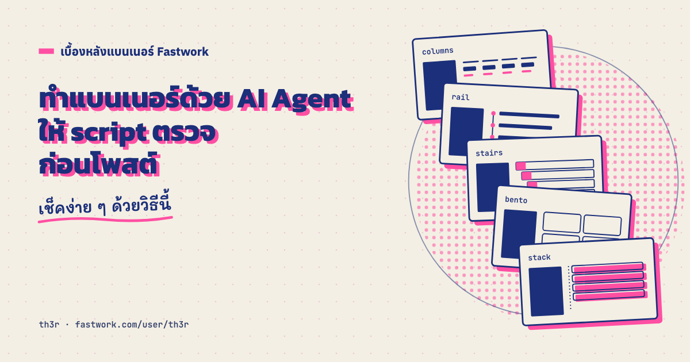

# Benchmark: banner-making-of

The case is [`../../benchmarks/banner-making-of.toon`](../../benchmarks/banner-making-of.toon). The
Thai prompt asks for blog titles about the most recent banner, how it was made with steps and method,
and a close of "if you want ... if you're interested ... hire me on Fastwork". It was translated to
English before any work, and both versions are in the case.

| File | What it is |
|---|---|
| [titles.md](titles.md) | 5 titles, 6 hooks (one per type) |
| [post.th.md](post.th.md) | the post, Thai, personal blog register (ผม, ครับ at the opening and sign-off), 1,721 of 2,000 characters |
| [post.banner.json](post.banner.json) | every image of the post in one spec (`pages`): cover, four steps, the closing banner |
| `cover-{riso,riso-night}-{1200x630,1920x1080}.png` | the cover, two styles, two sizes |
| `step-{1..4}-riso-1200x675.png` | one image per step |
| `end-riso-1200x675.png` | the finished th3r banner (stack layout), restyled in the post's riso theme |



## Scores

```
PASS  titles  5 title options
PASS  steps   4 numbered steps
PASS  method  all named
PASS  hook    found ['ถ้าอยาก', 'หากสนใจ']
PASS  cta     linked
PASS  dashes  0 dashes
PASS  facts   10 numbers, all in facts
PASS  length  1721 of 2000 characters
PASS  images  6 images
banner-making-of: 9/9 pass
```

All nine images pass `bench.py` (four covers, four steps, the closing banner): no core text in the
edge band, and the lowest text contrast is 8.78:1 (riso) and 9.44:1 (riso-night). On the covers the title is still 23.8px tall on a
400px-wide phone card, and the PNGs are 140 to 270 KB.

## What failed and how it was fixed

1. The `titles` check counted 11 options because it also counted the numbered hooks. It now counts
   only the first `##` section of the titles file.
2. The post said a whole rebuild is pixel-identical. Embedded font bytes change between builds, so
   the claim was cut.
3. The first covers failed the bench three ways. The kicker sat in the core zone at 6.9px on a phone
   card, so it became support. Thai ascenders pushed its box into the top edge band, and Kanit's
   overhang pushed the title into the left band, so the text column is inset by 8px.
4. A cover rendered as broken XML (an unclosed group) and still passed, because Chromium draws a
   broken SVG up to the error. The bench now fails on a parse error, and the renderer's selftest
   parses every layout.
5. "ทำ" rendered as "ท" and a gap. Chromium's Thai shaper splits ำ into ํ + า and looks both up
   by codepoint, and the subset font had no cmap entries for them. The subsetter now keeps both
   whenever ำ appears, and the selftest checks for them.
6. The cover note "bench จับผิดผม 3 รอบ" only made sense after reading the post (the user's review).
   It became "เช็คง่าย ๆ ด้วยวิธีนี้".
7. The kien-thai audit found the post crediting the bench with all three mistakes. The script caught
   two; the made-up "Remote" was found by re-reading, since a script can't know what is true. The
   post, a title option and the case's facts now say so. The same pass removed a มัน, explained 4.5:1
   for buyers, and replaced a calqued "ผลที่ได้คือ".
8. The first post ran to six steps and 3,336 characters of shown text. It was cut to four steps
   (rules and content merged; styles folded into the bench step) and checked by the new `length` row.
9. The `facts` check read sizes in image file names (`-1200x675.png`) as claims. Image targets and
   link URLs are no longer prose to it.
10. The checklists and the code in the step cards sat at the top of their cards with half the card
    empty; the visuals are now centred vertically.

## Reviews

- kien-thai: register personal blog, ผม from the prompt's own "จ้างผม", no mid-paragraph periods,
  pivots with แต่ and demonstratives, no recap close. No Thai-native model was running
  (`thai-route.sh` exit 3), so the draft was written and audited directly.
- humanizer: no em or en dashes, no not-X-but-Y staging, no unsourced claims left in the skill docs.
