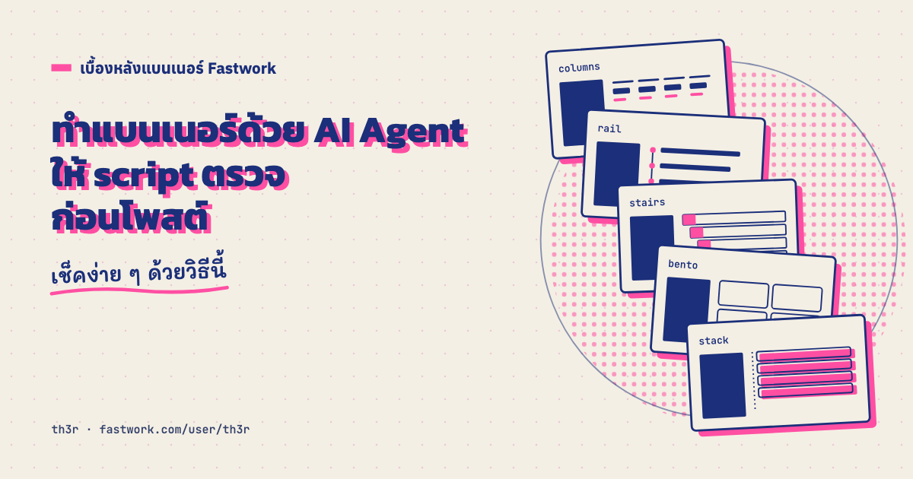
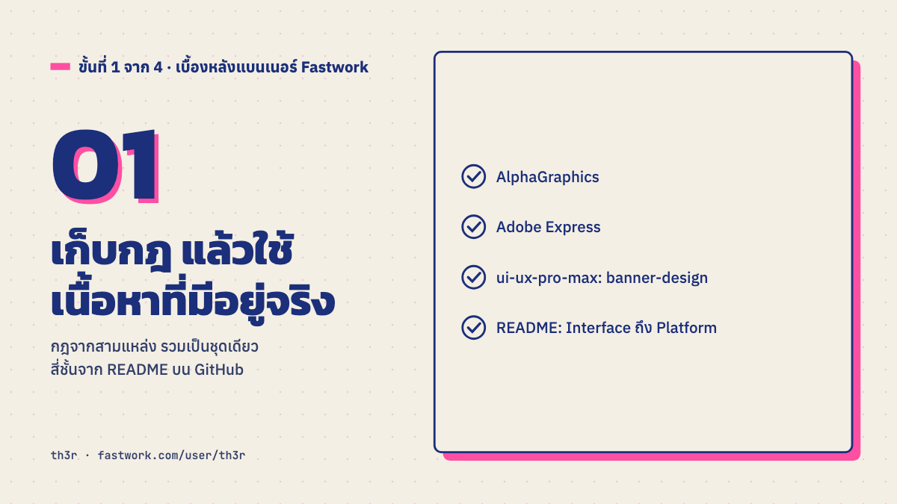
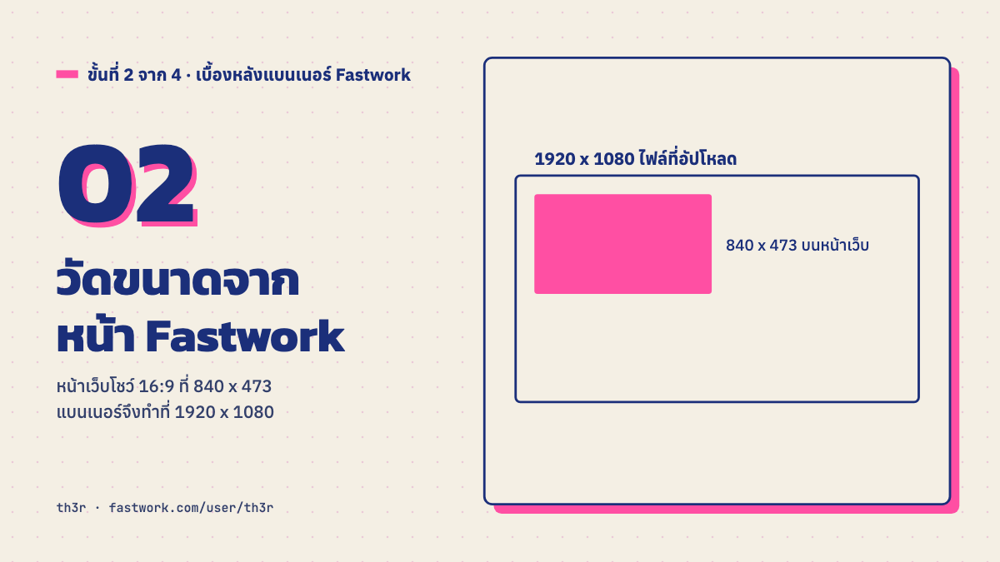
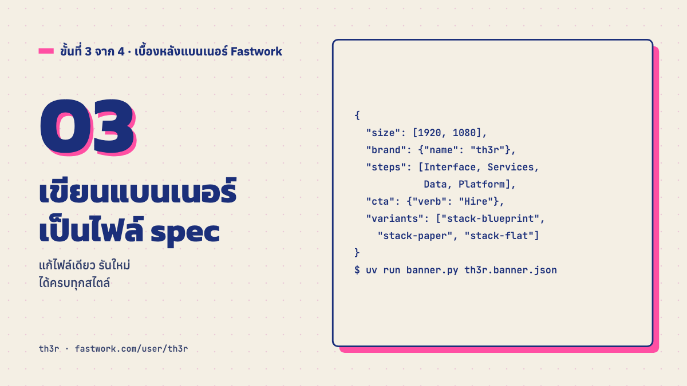
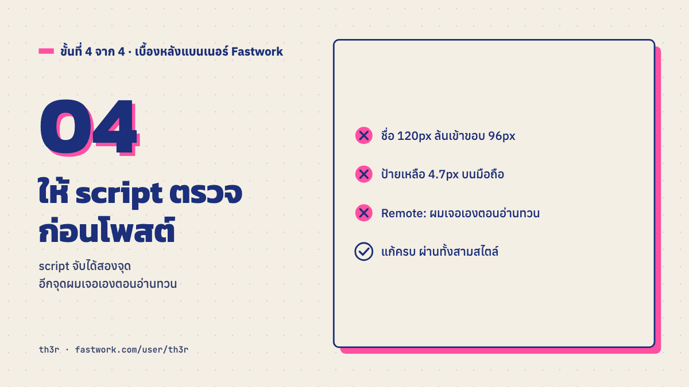
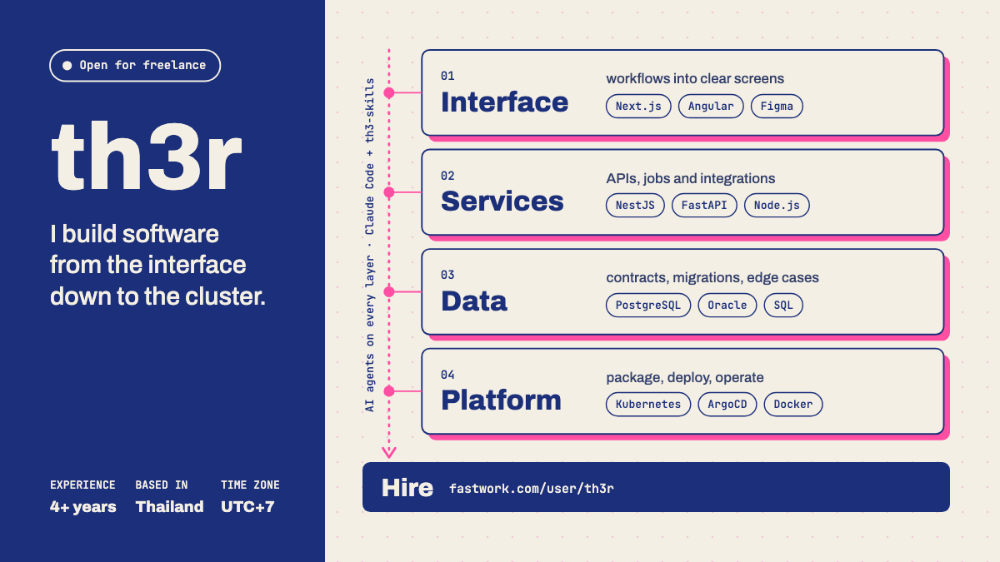

# ทำแบนเนอร์ด้วย AI Agent ให้ script ตรวจก่อนโพสต์

สวัสดีครับ โพสต์แรกบน Fastwork ของผมต้องมีแบนเนอร์สักใบ ผมเลยให้ AI Agent อย่าง Claude Code เขียนแบนเนอร์เป็นไฟล์ แล้วให้ script ตรวจก่อนโพสต์ ทั้งหมดใช้ skill จาก th3-skills ที่ผมเปิดไว้บน GitHub ที่ [github.com/th3r-dev/th3-skills](https://github.com/th3r-dev/th3-skills) สุดท้ายได้แบนเนอร์ 1920 x 1080 สามสไตล์จากไฟล์เดียว ระหว่างทางพลาดไปสามจุด เล่าไว้ข้างล่างทั้งหมด

## 1. เก็บกฎ แล้วใช้เนื้อหาที่มีอยู่จริง

ผมรวมกฎทำแบนเนอร์จาก AlphaGraphics, Adobe Express และ skill banner-design ของ ui-ux-pro-max เป็นชุดเดียว เนื้อหาก็ไม่คิดใหม่ ใช้สี่ชั้นที่เขียนไว้ใน README บน GitHub คือ Interface, Services, Data และ Platform จะได้ไม่เขียนเกินจริง

## 2. วัดขนาดจากหน้า Fastwork

Fastwork ไม่ได้บอกขนาดรูปไว้ ผมเลยวัดจากหน้าบริการจริง กรอบรูปเป็น 16:9 ขนาด 840 x 473 แบนเนอร์จึงทำที่ 1920 x 1080 ตัวหนังสือจะได้คมตอนอัปโหลด

## 3. เขียนแบนเนอร์เป็นไฟล์ spec

ทั้งใบอยู่ใน `th3r.banner.json` ทั้งข้อความ สี่ชั้น ปุ่มจ้าง และสีของแต่ละสไตล์ แล้ว `banner.py` ก็วาดออกมาเป็น SVG อยากเปลี่ยนอะไรก็แก้ไฟล์เดียวแล้วรันใหม่ ได้ครบทุกสไตล์

## 4. ให้ script ตรวจก่อนโพสต์

`bench.py` เปิดแบนเนอร์ใน browser แล้ววัดจริง ว่าของสำคัญไม่ล้นขอบ สีตัวอักษรต่างจากพื้นอย่างน้อย 4.5:1 และยังอ่านออกตอนย่อเหลือ 400px เท่าการ์ดบนมือถือ

script จับได้สองเรื่อง ชื่อ th3r ขนาด 120px ล้นเข้าขอบ 96px กับป้าย Open for freelance ที่เหลือ 4.7px บนมือถือ เรื่องที่สามผมเจอเองตอนอ่านทวน แถวข้อมูลเขียนว่า Remote ทั้งที่ผมไม่เคยบอกที่ไหน เลยเปลี่ยนเป็น UTC+7 ตาม README เรื่องนี้ script ตรวจไม่ได้ เพราะไม่มีทางรู้ว่าข้อไหนจริง

แก้ครบแล้วทั้งสามสไตล์ก็ผ่าน ผมเลือก blueprint ลง Fastwork

ถ้าอยากได้แบนเนอร์หรือหน้าเว็บที่ตรวจได้ก่อนปล่อยแบบนี้ หรือระบบตั้งแต่หน้าจอไปจนถึง cluster ที่คนทำยังอยู่ดูแลต่อ หากสนใจ ทักมาเล่าโจทย์ได้เลย จ้างผมได้ที่ [fastwork.com/user/th3r](https://fastwork.com/user/th3r) ครับ
