<p align="center"></p>

# pdf-operations

PDF work through the existing pipeline. Merge, split, reorder, rotate and overlay with pdf-lib.

The agent's instructions are in [SKILL.md](SKILL.md).

```
npx skills@latest add th3r-dev/th3-skills --skill pdf-operations
```
