<p align="center"></p>

# podman-disk-reclaim

Podman ate the disk. Get it back. Windows, macOS and Linux, one stdlib Python script.

The agent's instructions are in [SKILL.md](SKILL.md).

```
npx skills@latest add th3r-dev/th3-skills --skill podman-disk-reclaim
```
