<p align="center"></p>

# prompt-cache-kit

Cheaper agent runs, same prefix every time. Agent briefs share one byte-stable outline, so the prompt cache hits.

The agent's instructions are in [SKILL.md](SKILL.md).

```
npx skills@latest add th3r-dev/th3-skills --skill prompt-cache-kit
```
