<p align="center"></p>

# cross-agent-skills

Make a skill — or a whole project — usable by any coding agent (Codex, Cursor, Gemini CLI, an MCP
client), not just Claude, and hand work off between them reliably. Built from a real run: a Codex
session built a Roblox game with the `game-dev` skill, then was interviewed about what it read,
skipped and worked around. Pairs with [`agent-kit`](../agent-kit/SKILL.md)'s `team` (the handoff
protocol) and `cost`.

The agent's instructions are in [SKILL.md](SKILL.md).

```
npx skills@latest add th3r-dev/th3-skills --skill cross-agent-skills
```
