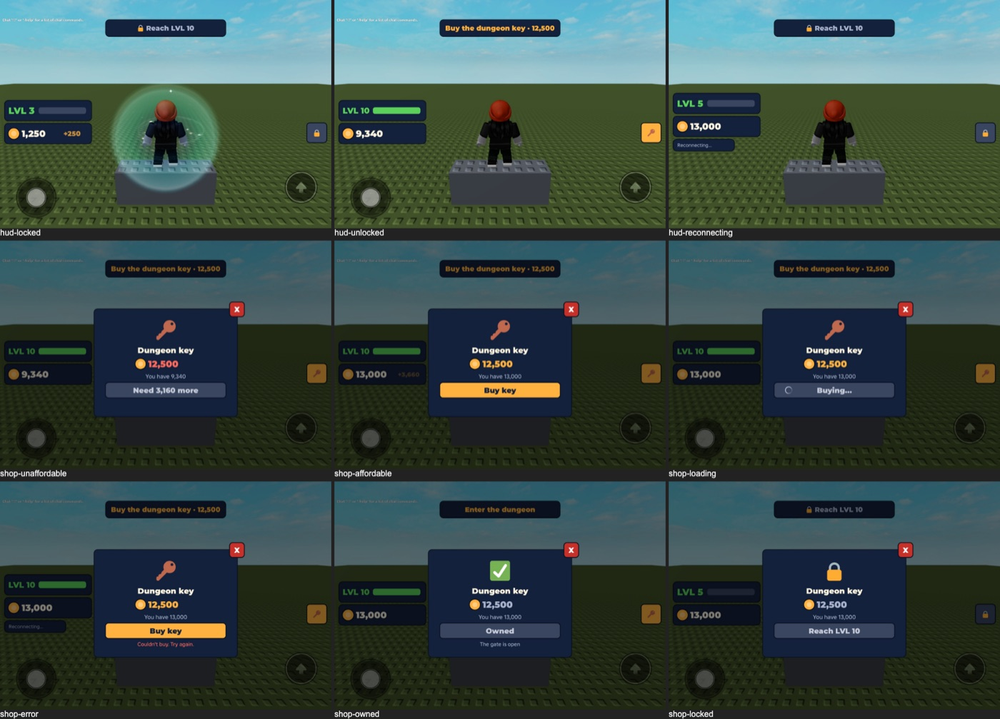
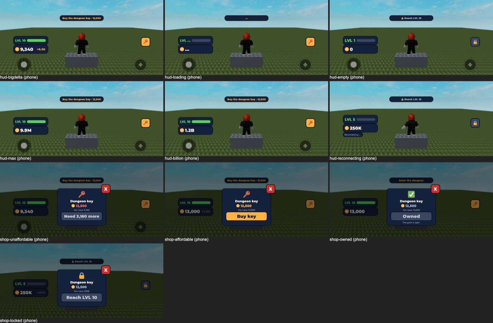

# Craghold: HUD and dungeon-key shop

The interface of Craghold, the mock game whose thumbnails design's thumbnail-keyart makes: level up
on the farm, earn gold, buy the dungeon key. It ran the whole design-ui workflow, with Studio as the
judge.



## What's here

| Path | What it is |
|---|---|
| `design/DESIGN.md`, `design/features/{hud,key-shop,settings}/design.md` | the briefs, approved before building, revised and re-approved after the playtests; `DESIGN.md` holds the style contract |
| `src/shared/` | pure modules tested under Lune: `Tokens` (colours, fonts, shape), `Gold` ("12,500", "9.9M"), `Progress` (level, XP, the farm cap), `KeyOffer` (every shop state in one function, and the server's `canBuy`), `Settings` (the clean-up rule both sides run, the effects level), `Count` (a counter's tick-up steps), `LayoutRules` (the layout lint's rules on plain rectangles), `Net` (names) |
| `src/client/` | `Theme` (tokens to Color3 and Font), `Ui` (the factory: plates, text with a size floor, buttons with press feedback, a drawn coin, a spinner), `Juice` (tick-up, pop, flash, each following the effects level), `LayoutLint` (prints `LINT` lines from the live ScreenGuis; runs by itself in Studio 5 s after start), `Hud`, `KeyShop`, `SettingsPanel` |
| `src/server/` | owns gold, level and the key; grants loop income so the HUD moves; the `BuyKey` RemoteFunction decides every purchase. Studio-only switches (`PurchaseDelay`, `FailPurchases`, `PauseServer`, `FailSettings`) force the loading, error and reconnecting states for captures. `SaveSettings` cleans the panel's table with `Settings.validate` and keeps it for the session only: the example has no DataStore |
| `default.project.json` | the Rojo tree, with the baseplate, spawn and the dungeon gate's "E" prompt as data |
| `tests/run.luau` | 17 Lune tests: token contrast ≥ 4.5:1, font weights that exist, formatting and suffixes (100K, 9.9M, 1B…), progress, every KeyOffer state, the server check agreeing with the view, settings clean-up and the effects level, tick-up steps, and each layout-lint rule firing once on a known-bad layout and never on a clean one |
| `captures/` | Studio playtest captures |

## Run it

From this folder, in any shell (no agent needed):

```bash
rokit install                 # rojo, lune, selene, stylua at the pinned versions
lune run tests/run            # Tests: 17 passed, 0 failed
selene src && stylua --check src tests
rojo build . -o craghold-hud.rbxl     # open it in Studio and press Play
```

With Studio's MCP server on, an agent playtests and captures it:
`python ../../../roblox/scripts/roblox_setup.py mcp` (Claude Code by default; `--client` for the others).

## What the playtests found

Ten builds ran in Studio. Each pass found something the files alone couldn't:

| Pass | Found | Fixed |
|---|---|---|
| 1 | `Black is not a valid member of "Enum.FontWeight"`: the client stopped before drawing anything. The place had no ground | `Heavy`, plus a test that every weight is real; a baseplate in the project |
| 2 | No StyleSheet applied: plates transparent, text default. Five minimal probes (runtime and edit, parented or not, class and tag selectors) all failed. The coin emoji drew an empty box. Roblox's chat covered the top-left stack | tokens applied by one function (`Ui.tone`); a drawn coin; the stack moved to left-middle (brief re-approved) |
| 3 | The capture script's clicks never ran: Studio MCP's input tools need `datamodel_type` | the script |
| 4 | Escape reaches the game already processed (it's Roblox's menu), so it can't close the shop; chat's input bar reached the stack | close with X, backdrop or B; stack centred at 50% (both briefs updated) |
| 4, phone | the stack and Shop button clear the thumbstick and jump; the dim stopped at the safe insets; "You have …" rendered about 8 px. Simulated mouse clicks don't open the shop under touch emulation | the dim on its own full-bleed ScreenGui |
| 5-6, tablet | a fresh-eyes review scored accessibility and mobile fit 6: small secondary text, no spinner in "Buying…" | a 14 px text floor (measured 22-27 px on the tablet), a spinner, more padding |
| 7, phone | the text floor overflowed the objective pill ("Buy the dungeon key ·", price cut); the XP bar kept its old fill while loading | a wider pill, capped on big screens; the bar empties while loading |
| 8-10, phone | a big gold jump's delta overflowed ("+8,34"); huge counts need a suffix | `Gold.short`: exact below 100,000, then "100K", "9.9M", "1B", T, Qa, Qi, rounded down; the delta compact from 1,000 |

A purchase the client asked for while it showed 13,000 gold came back `granted=false reason=locked`:
the server held its own values. That's the trust boundary, run, not assumed.

## Settings, juice and the lint (2026-11-24)

Added after a game built with this skill reached its owner looking like a tool panel. The HUD
brief already asked for a gold count-up, a level-up flash and a bounce on the bought key; the
first build had shipped without them. They now come from `Juice`, and the Settings panel's
effects level reaches every one of them.

The modules and their rules are tested under Lune (17 passing), `selene` and `stylua` are clean,
and `rojo build` succeeds. **NOT ASSESSED** until a Studio playtest runs (Studio MCP wasn't
connected for this change): the Settings panel in each state across the viewport matrix, the `LINT`
output at each size, the effects at Full and at Off, the sliders on touch, and whether the gear
glyph `⚙` draws on every platform (the coin emoji didn't, which is why the coin is drawn).

## Device coverage

| Device | Viewport | States captured | Notes |
|---|---|---|---|
| Phone (emulator) | 750×381, touch | 10, final build: HUD loading, empty, 9.9M, 1.2B, big delta, reconnecting; shop unaffordable, affordable, owned, locked | the shop opened by enabling its ScreenGui: MCP mouse clicks don't reach buttons under touch emulation, so phone taps and the click-driven loading and error states are NOT ASSESSED there (the tablet shows both) |
| Tablet (emulator) | 1209×834, touch | all 9 (build 7): the 4 HUD and 7 shop states, the spinner | the Shop button moves to 55% height for the thumb |
| Desktop | 1920×842 window | all 9, build 4 | captures not kept; the final build wasn't re-run on desktop. The B key and the 520 px dialog cap were exercised in build 4 |



## Review

Scored by a fresh-context reviewer on the captures, three rounds (design-core's limit). Round 1 failed
accessibility and mobile fit at 6; round 2 left three rows at 7; round 3 below.

| Row | Score | Evidence |
|---|---|---|
| Hierarchy and emphasis | 8 | the objective, the gold count and the Buy button lead in every frame |
| Alignment, proximity, white space | 8 | even padding, centred price row, full-width Buy |
| Consistency | 8 | tokens hold on phone and tablet; the emoji key is a known stand-in |
| Copy | 8 | nothing truncates; "9.9M", "1.2B" |
| States and edge cases | 8 | every HUD state on the phone, all 9 on the tablet |
| Accessibility | 8 | measured on the phone: 15 px secondary text, 28 px gold and buttons; every text/plate pair ≥ 4.5:1 by test |
| Fit to kind | 8 | reads as a Roblox game with its own navy-and-gold plates |
| Mobile fit | 8 | corners clear; Close, Shop and Buy 44×44, 44×44, 217×44 |
| Trust boundary | 8 | run in Studio (below) |
| Closeness to references | NOT ASSESSED | the thumbnail wasn't in the captures |
| First action | NOT ASSESSED | needs a timed new-player run |

Trust boundary, run in Studio through the client's own remote: a request at level 5 showing 13,000 gold
→ `granted=false reason=locked`; at level 10 with 19,250 gold → `granted=true`, the server took the 12,500
and set the key; asked again → `granted=false reason=owned`, gold and key unchanged. The short-of-gold
refusal is covered by the Lune test of `KeyOffer.canBuy`, which the server calls.

Open, from the review: a phone capture with chat expanded; the chip's measured size on the phone; the
tablet captures predate the cream spinner ring; phone shop-loading and shop-error (touch emulation
ignores MCP clicks); desktop at 1920×1080 on the final build.

## Known stand-ins

- Icons are emoji (🔑 🔒 ✅). Their colours are the font's, so tokens can't tint them. A shipped game
  uploads white icons and tints them with `ImageColor3` ([visual.md](../../references/visual.md)).
- The loop is simulated: the server grants 250 gold and 60 XP every 2 s instead of a farm.
