<p align="center"></p>

# plans

Plan-then-build toolkit, one orchestrator over the other th3-skills.

| Part | What it does |
|---|---|
| orchestrator ([SKILL.md](SKILL.md)) | Routes a loose idea through four phases: agent-kit sets up the team and model routing, design plus a councilled SRS cleans the requirement, qa and devops build it cheap and fast with a `--selftest` on every script, then it ships as a ticket and a PR |
| [`poc-spec-driven-builder`](poc-spec-driven-builder/SKILL.md) | The engine: research → SRS → five-advisor council → test matrix → build-to-green → report → PR, run autonomously without pausing for clarification |
| [`templates/`](templates/) | The work bundle Phase 0 copies into a project's `.claude/`: a role-agent rule, a lead-loop command, a team board config and an MCP config stub |

The agent's instructions are in [SKILL.md](SKILL.md); the background is in [references/best-practices.md](references/best-practices.md).

```
npx skills@latest add th3r-dev/th3-skills --skill plans
```
