<p align="center"></p>

# software-engineer

Software engineering toolkit, one skill with sub-skills.

| Sub-skill | What it does |
|---|---|
| [`release-docs`](release-docs/SKILL.md) | The release report for the PM, the BA and QA — what goes up in vX.Y.Z, a before/after screenshot per change, the open BA decisions and the staging test plan — from a Thai or English template, checked by a script and rendered to PDF in the documentation house style |

The agent's instructions are in [SKILL.md](SKILL.md).

```
npx skills@latest add th3r-dev/th3-skills --skill software-engineer
```
