<p align="center"></p>

# th3-skills

The front door to the whole toolkit. Read the task, route it to the skill that owns it — `plans` for a
build, `design` for UI, `qa` / `devops` for test and infra, and so on. It routes; the owning skill does
the work. It's the default way to start a job in any project that has th3-skills installed.

The routing table and rules are in [SKILL.md](SKILL.md).

```
npx skills@latest add th3r-dev/th3-skills --skill th3-skills
```
