<p align="center"></p>

# social-media

Social and blog content, one skill with sub-skills.

| Sub-skill | What it does |
|---|---|
| [`blog-post`](blog-post/SKILL.md) | Five titles, six typed hooks and a Thai or English post, grounded only in supplied facts, closed with an "if you want ..." hook and a hire link; Thai written with `kien-thai`, every draft reviewed with `humanizer`, checked with `bench_post.py` |
| [`blog-cover`](blog-cover/SKILL.md) | The post's cover at 1200 × 630 and 1920 × 1080, rendered by design's banner-design engine (`cover` layout) and benched; Thai in Kanit, Anuphan and Mali |

Benchmark cases are TOON files in [`benchmarks/`](benchmarks/): the prompt, its English translation,
the facts a post may cite and a rubric. The worked case is
[banner-making-of](examples/banner-making-of/RESULTS.md).

The agent's instructions are in [SKILL.md](SKILL.md).

```
npx skills@latest add th3r-dev/th3-skills --skill social-media
```

`kien-thai` and `humanizer` are separate skills; install them for the Thai and review passes.
