<p align="center"></p>

# thai-mock-naming

Thai mock names that are **unmistakably fake**, **greppable in a database**, and still **structurally valid enough to exercise real Thai text handling**.

Thai mock data converges on `สมชาย ใจดี` and `สมหญิง พอใจ`. Those are real, common Thai names — thousands of citizens match them. This skill replaces them with marker names like `ทดสอบ นามสมมุติ`, and ships a generator and a linter to keep it that way.

```
สมชาย ใจดี          →   ทดสอบ นามสมมุติ
สมหญิง พอใจ         →   ตัวอย่าง ข้อมูลจำลอง
มานี รักเรียน         →   ทดสอบ ผู้ยื่นคำขอ
```

## Why

| Problem with plausible names | What a marker name fixes |
|---|---|
| Test rows are indistinguishable from production rows | `WHERE first_name LIKE 'ทดสอบ%'` is a complete census of fake records |
| A demo screenshot looks like leaked personal data under PDPA | Nobody has to verify whether `ทดสอบ นามสมมุติ` is a real person |
| Real complaints get dismissed as "that's just test data" | Real and fake are legible at a glance, in both directions |
| The name says nothing about which fixture it came from | `ทดสอบ ผู้อนุมัติ` names its own role in the flow |

## Install

Copy into a project's skills directory:

```bash
cp -r skills/thai-mock-naming ~/.claude/skills/
```

Or via [`npx skills`](https://dev.to/baltz/sharing-skills-with-npx-2nbc):

```bash
npx skills@latest add TheeraphatStudent/th3-skills --skill thai-mock-naming
```

## Use

Generate a name set:

```bash
python3 scripts/gen_names.py --count 10                        # table
python3 scripts/gen_names.py --count 50 --format sql --seed 42
python3 scripts/gen_names.py --roles --titles                  # workflow cast
python3 scripts/gen_names.py --count 5 --with-id --with-contact
python3 scripts/gen_names.py --companies --count 5
python3 scripts/gen_names.py --edge-cases --format json        # QA stress set
```

```
index  title   given_name   surname      full_name
-----  ------  -----------  -----------  -------------------------
1      นาย     ทดลองชาย     ผู้ยื่นคำขอ      นาย ทดลองชาย ผู้ยื่นคำขอ
2      นาง     ตัวอย่างหญิง    ผู้อนุมัติ       นาง ตัวอย่างหญิง ผู้อนุมัติ
3      นางสาว  สมมุติหญิง      ผู้ตรวจสอบ    นางสาว สมมุติหญิง ผู้ตรวจสอบ
```

`--seed` makes output deterministic, so regenerating a fixture gives a stable diff.

Audit an existing codebase:

```bash
python3 scripts/check_mock_names.py path/to/seeds/
python3 scripts/check_mock_names.py . --quiet      # exit code only, for CI
python3 scripts/check_mock_names.py . --format json
```

Exits non-zero on any finding. Three ways to suppress a known-good hit:

| Mechanism | Use |
|---|---|
| `--exclude GLOB` | one-off, repeatable |
| `.mocknamesignore` | one glob per line, committed to the repo |
| `mock-names-ignore` | a marker in a comment on the line itself |

## National ID safety

`--with-id` emits 13-digit national IDs that **deliberately fail the checksum** and use an unissued leading digit. A mock ID with a *valid* checksum is a well-formed Thai national ID, and somewhere a citizen holds it.

The property is tested, not asserted — see `tests/test_gen_names.py::test_generated_ids_never_have_a_valid_checksum`, which checks 20,000 generated IDs across 20 seeds.

> Keep the shape, break the check: a mock identifier should pass every format check and fail every authenticity check.

## Thai word segmentation

Thai has no spaces between words, so substring matching produces false positives. `จำลอง` is a real given name *and* the tail of the approved marker `ข้อมูลจำลอง`. The linter splits each line into maximal Thai runs and judges the run as a whole:

| Input | Result |
|---|---|
| `จำลอง` | flagged — a real given name standing alone |
| `ข้อมูลจำลอง` | clean — approved marker |
| `การจำลองสถานการณ์` | clean — ordinary Thai word |
| `สมชายใจดี` | flagged twice — two real names concatenated |

## Contents

```
SKILL.md                      the rule, the tiers, and when not to use it
references/name-bank.md       approved tokens, ready-made sets, blocklist
references/edge-cases.md      length, tone marks, การันต์, ณ-surnames, collation
references/identity-fields.md national ID, phone, email, address, postcode
scripts/gen_names.py          generator
scripts/check_mock_names.py   linter
tests/                        98 tests
```

## Development

```bash
pip install -e '.[dev]'
pytest
```

Runtime code has no third-party dependencies and targets Python 3.8+.

## Related

- [kien-thai (เขียนไทย)](https://github.com/chakrit/kien-thai) by chakrit — writes Thai that Thai readers find easy to read. This skill covers the identity fields; kien-thai covers the Thai prose in every other field. **This skill decides what cannot look real; kien-thai decides what must not sound machine-made.**

## License

MIT
